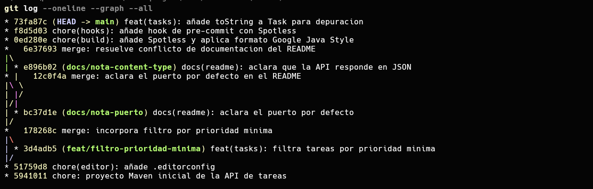
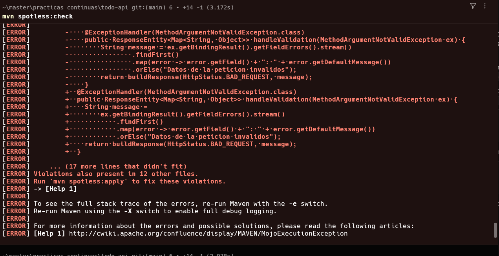
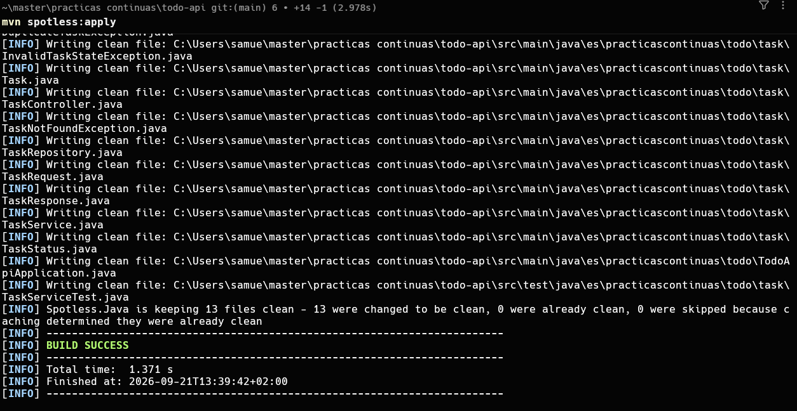
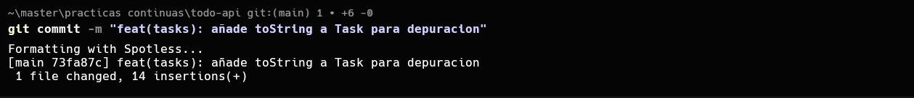
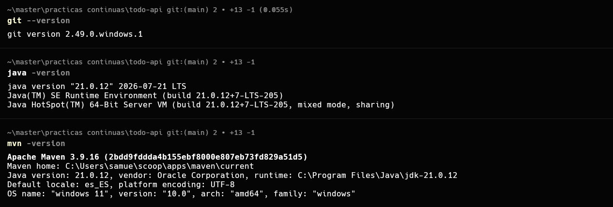
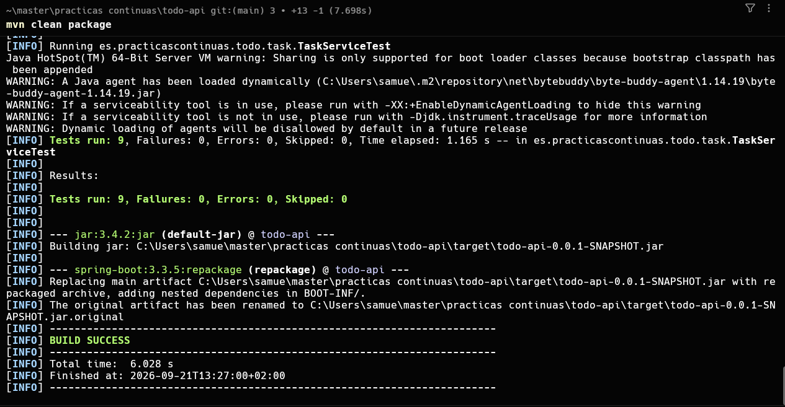
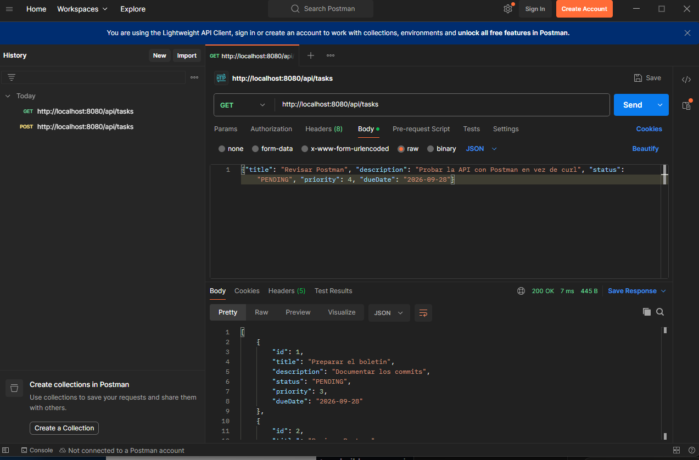

# Boletín 1 · Git y proyecto Maven

> Repositorio local (pendiente de publicar en GitHub en el Boletín 2, según el propio enunciado del Boletín 2). Los enlaces a commits se añadirán cuando el repositorio sea público.

## Resumen de commits

| # | Commit | Mensaje | Qué se hizo | Autor |
|---|--------|---------|-------------|-------|
| 1 | `5941011` | `chore: proyecto Maven inicial de la API de tareas` | API REST de tareas (Spring Boot 3 + Java 21) con capas, persistencia JPA/H2, validaciones, manejo de errores y 8 tests de negocio. | Samuel Avilés Conesa |
| 2 | `51759d8` | `chore(editor): añade .editorconfig` | Indentación y finales de línea comunes para todos los editores. | Samuel Avilés Conesa |
| 3 | `3d4adb5` | `feat(tasks): filtra tareas por prioridad minima` | Endpoint `GET /api/tasks/priority?min=N`, con su test, en rama `feat/filtro-prioridad-minima`. | Samuel Avilés Conesa |
| 4 | `178268c` | `merge: incorpora filtro por prioridad minima` | Fusión de la rama anterior en `main`. | Samuel Avilés Conesa |
| 5 | `bc37d1e` | `docs(readme): aclara el puerto por defecto` | Primera rama del conflicto provocado a propósito (Parte F). | Samuel Avilés Conesa |
| 6 | `e896b02` | `docs(readme): aclara que la API responde en JSON` | Segunda rama, editando la misma línea del README de forma incompatible. | Samuel Avilés Conesa |
| 7 | `12c0f4a` | `merge: aclara el puerto por defecto en el README` | Fusión limpia de la primera rama en `main`. | Samuel Avilés Conesa |
| 8 | `6e37693` | `merge: resuelve conflicto de documentacion del README` | Fusión de la segunda rama: conflicto real, resuelto a mano conservando ambas aclaraciones. | Samuel Avilés Conesa |
| 9 | `0ed280e` | `chore(build): añade Spotless y aplica formato Google Java Style` | Plugin `spotless-maven-plugin` en el `pom.xml` y primer formateo de todo el código con Google Java Format. | Samuel Avilés Conesa |
| 10 | `f8d5d03` | `chore(hooks): añade hook de pre-commit con Spotless` | Hook versionado en `.githooks/pre-commit`, y activación (`core.hooksPath`) para la demo en vivo del hook (ver Parte E). Este es el commit en la punta de `main`. | Samuel Avilés Conesa |

## Detalle por commit

### 1. `chore: proyecto Maven inicial de la API de tareas`
- **Qué se hizo:** API REST de gestión de tareas (entidad `Task`: título, descripción, estado, prioridad, fecha límite), con Spring Data JPA + H2 en memoria, capas controlador/servicio/repositorio, `@RestControllerAdvice` que traduce `TaskNotFoundException`→404, `DuplicateTaskException`→409, `InvalidTaskStateException`→422 y errores de validación→400. Incluye 8 tests unitarios de reglas de negocio reales: título duplicado, alta válida, tarea inexistente (`findById` y `delete`), no reactivar una tarea completada, borrado, filtro por estado y filtro por prioridad mínima.
- **Relación con el boletín:** Partes B y C.
- **Uso de IA:** Se pidió a Claude la creación del código.

### 2. `chore(editor): añade .editorconfig`
- **Qué se hizo:** UTF-8, LF, 4 espacios (2 en YAML/JSON).
- **Relación con el boletín:** Parte D.

### 3-4. `feat(tasks): filtra tareas por prioridad minima` + merge
- **Qué se hizo:** en la rama `feat/filtro-prioridad-minima` se añadió `GET /api/tasks/priority?min=N` (repositorio → `findByPriorityGreaterThanEqual`, servicio, controlador) junto con su test. Se fusionó después en `main` (fast-forward).
- **Relación con el boletín:** Parte D — creación de rama, cambio no trivial con test, merge y revisión del historial (`git log --oneline --graph --all`).

### 5-8. Conflicto provocado y resuelto
- **Qué se hizo:** desde el mismo commit base se crearon dos ramas (`docs/nota-puerto` y `docs/nota-content-type`) que editaron de forma incompatible la misma línea del `README.md`. La primera se fusionó sin problema (`12c0f4a`). La segunda produjo un conflicto real (`CONFLICT (content): Merge conflict in README.md`), que se resolvió a mano eliminando los marcadores `<<<<<<<`/`=======`/`>>>>>>>` y conservando ambas aclaraciones en una sola frase.
- **Relación con el boletín:** Parte F, completa.

### 9. `chore(build): añade Spotless y aplica formato Google Java Style`
- **Qué se hizo:** se añadió `spotless-maven-plugin` 2.43.0 (Google Java Format, borrado de imports no usados, limpieza de espacios finales, salto de línea final) y se ejecutó `mvn spotless:apply` por primera vez, reformateando todo el código fuente existente.
- **Relación con el boletín:** Parte E. Antes de este commit se comprobó que `mvn spotless:check` fallaba porque el código aún no estaba formateado:

y que `mvn spotless:apply` lo corregía:

### 10. `chore(hooks): añade hook de pre-commit con Spotless`
- **Qué se hizo:** se versionó `.githooks/pre-commit` (ejecuta `mvn -q spotless:apply` y vuelve a añadir los archivos reformateados) y se activó con `git config core.hooksPath .githooks`.
- **Relación con el boletín:** Parte E.
- **Demostración en vivo (no genera un commit propio):** se desordenó a propósito la indentación de `TaskStatus.java` y se hizo `git add -A && git commit`. El hook imprimió `Formatting with Spotless...`, ejecutó `mvn spotless:apply` y devolvió el archivo exactamente al formato ya commiteado **antes** de confirmar el commit. Por eso ese commit no aparece como un commit independiente en el historial final: no contenía ningún cambio real, ya que Spotless deshizo la mala indentación antes de que se guardara nada. Es precisamente la prueba de que, con el hook activo, es imposible commitear código sin formatear.

## Descripción narrativa de la sesión

### Parte A — Entorno
Comprobación de versiones en la máquina real (no en un entorno intermedio): `git --version` → 2.49.0, `java -version` → **21.0.12**, `mvn -version` → Apache Maven 3.9.16 con Java 21.

### Parte B y C — Generación y prueba de la API
La aplicación se generó con ayuda de IA siguiendo los requisitos mínimos del boletín (entidad con validaciones, persistencia JPA/H2, CRUD completo, capas, manejo de errores centralizado, ≥5 tests de negocio reales). Se construyó con `mvn clean package`:

Y se probó en caliente: `java -jar target/todo-api-0.0.1-SNAPSHOT.jar` y, con Postman (en vez de `curl`, por problemas de escapado de comillas con `curl.exe` en PowerShell), un `POST /api/tasks` (201 Created) seguido de un `GET /api/tasks` que muestra la tarea creada:

### Parte D — Flujo Git local
`git init`, `.gitignore`/`.gitattributes` en el primer commit, `.editorconfig` en un commit aparte, rama `feat/filtro-prioridad-minima` con un cambio no trivial (nuevo endpoint + test), fusión en `main` y revisión del grafo de commits.

### Parte E — Formateo automático
Se añadió Spotless, se comprobaron sus dos modos (`check` falla si algo no está formateado, `apply` lo corrige) y se automatizó con un hook de pre-commit versionado en `.githooks/`, activado con `git config core.hooksPath .githooks`. Se demostró en vivo que, aunque se deje una clase mal indentada, el hook la reformatea antes de que el commit se confirme.

### Parte F — Conflicto de merge
Dos ramas creadas desde el mismo punto modificaron la misma línea del `README.md` de forma distinta. La primera se fusionó sin incidentes; la segunda provocó un conflicto real que se resolvió a mano, conservando el contenido de ambas ramas.

## Verificación realizada

- `mvn clean package`: BUILD SUCCESS, 8 tests superados, jar generado en `target/todo-api-0.0.1-SNAPSHOT.jar`.
- Prueba funcional con Postman: `POST /api/tasks` (201) y `GET /api/tasks` (200) devolviendo la tarea creada.
- `mvn spotless:check` fallando en código sin formatear y `mvn spotless:apply` corrigiéndolo.
- Hook de pre-commit formateando automáticamente en un commit real.
- Historial de Git con ramas, merges y el conflicto resuelto.

(Todas estas capturas están incluidas en la sección correspondiente más arriba.)
