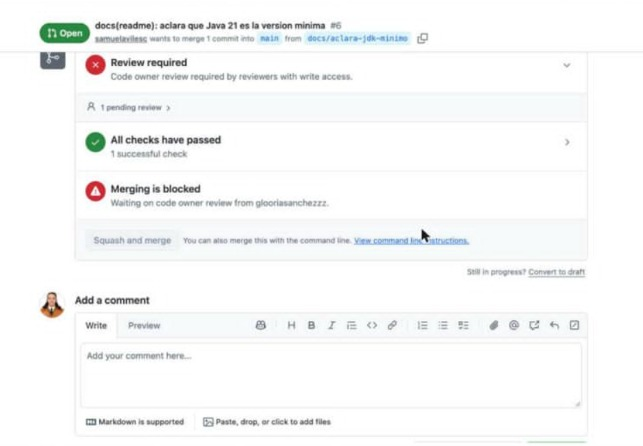
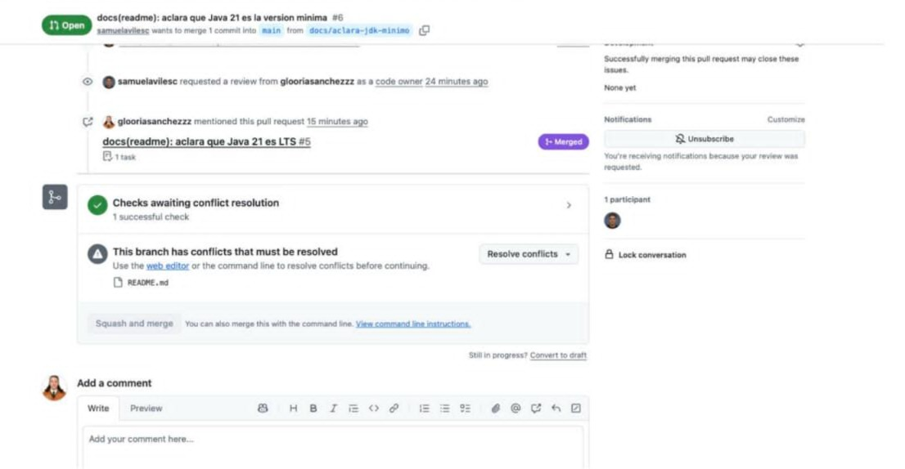
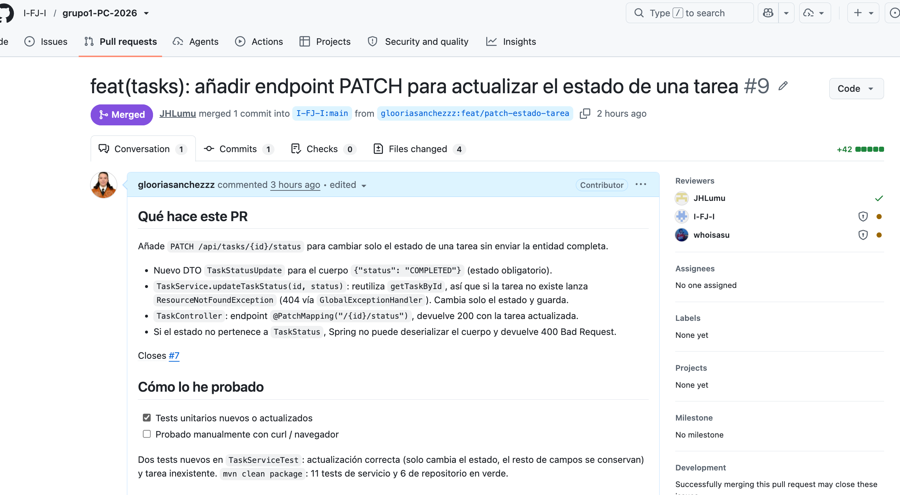
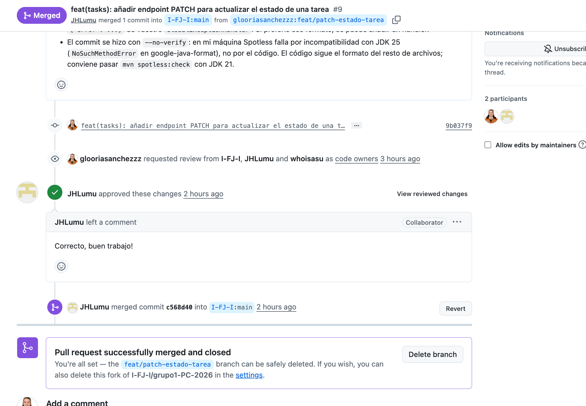

# Boletín 2 — GitHub y colaboración con Pull Requests

**Autores:** Gloria Sánchez Alonso y Samuel Avilés Conesa
**Repositorio:** https://github.com/samuelavilesc/practicas-continuas-gloriasamu

## Introducción

Este boletín parte del proyecto del Boletín 1 (la API de tareas en Spring Boot) y lo lleva a GitHub para trabajar con el flujo de colaboración real: ramas, Issues, Pull Requests, revisión cruzada y protección de `main`. Aquí el foco no está tanto en el código como en el proceso: que cualquier cambio pase por Issue → rama → PR → revisión → fusión, y que quede constancia de esa revisión en el repositorio.

El trabajo se repartió por partes, aunque casi todas acabaron requiriendo ida y vuelta entre los dos. Por eso en varios apartados se cuenta quién hizo qué.

## Resumen de commits

Commits de esta sesión que han llegado a `main`. Como la política de fusión es *squash and merge*, cada PR aparece como un único commit; los commits individuales de cada rama se detallan en la sección siguiente.

| # | Mensaje del commit | Qué se hizo | Autor | Enlace |
|---|--------------------|-------------|-------|--------|
| 1 | `chore: prepara gobernanza del repo (plantillas, CODEOWNERS, CONTRIBUTING)` | Plantilla de PR, plantillas de Issue, CODEOWNERS, CONTRIBUTING y README ampliado. Último push directo a `main` antes de protegerla. | Samuel Avilés Conesa | [bf2ffac](https://github.com/samuelavilesc/practicas-continuas-gloriasamu/commit/bf2ffac9105bb36b3e9d8ae8b810f50c1b5f1d31) |
| 2 | `feat(tasks): añade paginación al listado de tareas (#2)` | Endpoint `GET /api/tasks/page` con `Pageable`, con su test. Cierra el Issue #1. | Samuel Avilés Conesa | [ecb0928](https://github.com/samuelavilesc/practicas-continuas-gloriasamu/commit/ecb0928f7fb3191878f5ee9f5edd8bb8878c548c) |
| 3 | `feat(tasks): añade busqueda de tareas por texto (#4)` | Endpoint `GET /api/tasks/search?q=` sobre título y descripción, con dos tests. Cierra el Issue #3. | Gloria Sánchez Alonso | [2ade813](https://github.com/samuelavilesc/practicas-continuas-gloriasamu/commit/2ade813b590c1b994397fcad82a33da47e14df8e) |
| 4 | `docs(readme): aclara que Java 21 es LTS (#5)` | Primera rama del conflicto provocado (Parte E). | Samuel Avilés Conesa | [6b87b42](https://github.com/samuelavilesc/practicas-continuas-gloriasamu/commit/6b87b4248f614ff1d828f26807e5da7f68904073) |
| 5 | `docs(readme): aclara que Java 21 es la version minima (#6)` | Segunda rama del conflicto, rebasada sobre `main` y resuelta en local. | Samuel Avilés Conesa | [8a18824](https://github.com/samuelavilesc/practicas-continuas-gloriasamu/commit/8a18824db901befef04586c0e8c47ae3d9af45c1) |
| 6 | `docs: actualiza tabla de endpoints, plantilla enhancement y entorno en CONTRIBUTING (#7)` | Renombra `feature.md` → `enhancement.md`, añade los endpoints nuevos al README y el arranque del entorno al CONTRIBUTING. | Gloria Sánchez Alonso | [e366a7e](https://github.com/samuelavilesc/practicas-continuas-gloriasamu/commit/e366a7e7b82eb5b8790397683c025e3bb88682e1) |

## Detalle por commit

### 1. `chore: prepara gobernanza del repo (plantillas, CODEOWNERS, CONTRIBUTING)`
- **Qué se hizo:** `.github/PULL_REQUEST_TEMPLATE.md`, `.github/ISSUE_TEMPLATE/bug.md` y `feature.md` (renombrada después a `enhancement.md` en el commit 6), `.github/CODEOWNERS` con los dos como propietarios de todo el código, `CONTRIBUTING.md` con el flujo de ramas y PRs, y README ampliado.
- **Autor:** Samuel Avilés Conesa.
- **Relación con el boletín:** Partes A y B. Se subió directamente a `main` porque la protección de rama todavía no estaba activada (Parte C).

### 2. `feat(tasks): añade paginación al listado de tareas (#2)`
- **Qué se hizo:** nuevo endpoint de listado paginado y ordenado con `Pageable` de Spring Data (controlador, servicio y test). Squash de dos commits de la rama `feat/paginacion-tareas`:
  - [`0712cb3`](https://github.com/samuelavilesc/practicas-continuas-gloriasamu/commit/0712cb34d226b3ec9337fd447247384a1f2e63d9) `feat(tasks): añade paginación al listado de tareas`: implementación inicial en `/api/tasks/pagina`.
  - [`a3e172a`](https://github.com/samuelavilesc/practicas-continuas-gloriasamu/commit/a3e172a5071f4d66959ec733850330597058c70d) `fix(tasks): renombra el endpoint de paginación a /page`: corrección pedida en la revisión de Gloria. Este commit caducó su primera aprobación.
- **Autor:** Samuel Avilés Conesa (revisora: Gloria Sánchez Alonso).
- **Relación con el boletín:** Parte D, ciclo 1. [Issue #1](https://github.com/samuelavilesc/practicas-continuas-gloriasamu/issues/1) (etiqueta `enhancement`) → [PR #2](https://github.com/samuelavilesc/practicas-continuas-gloriasamu/pull/2).

### 3. `feat(tasks): añade busqueda de tareas por texto (#4)`
- **Qué se hizo:** endpoint `GET /api/tasks/search?q=texto` (método derivado en el repositorio, servicio, controlador y tests). Squash de los commits de la rama `feat/busqueda-por-texto`:
  - [`00b68b8`](https://github.com/samuelavilesc/practicas-continuas-gloriasamu/commit/00b68b83de77403af10ae9c778b3fc36f046e01a) `feat(tasks): añade busqueda de tareas por texto`: implementación y test principal.
  - [`2929b4f`](https://github.com/samuelavilesc/practicas-continuas-gloriasamu/commit/2929b4fddb0dc8cda67180a4b7d50165041b9545) `Merge branch 'main' into feat/busqueda-por-texto`: Samuel trajo `main` (ya con el PR #2) a la rama con un merge. Por eso el commit squash lleva `Co-authored-by` de Samuel.
  - [`9b29d72`](https://github.com/samuelavilesc/practicas-continuas-gloriasamu/commit/9b29d722eba76f928ae4d18ea1f2736ba94400f7) `test(tasks): añade caso de busqueda sin coincidencias`: test pedido en la revisión de Samuel.
- **Autora:** Gloria Sánchez Alonso (revisor: Samuel Avilés Conesa).
- **Relación con el boletín:** Parte D, ciclo 2. [Issue #3](https://github.com/samuelavilesc/practicas-continuas-gloriasamu/issues/3) (etiqueta `enhancement`) → [PR #4](https://github.com/samuelavilesc/practicas-continuas-gloriasamu/pull/4).

### 4. `docs(readme): aclara que Java 21 es LTS (#5)`
- **Qué se hizo:** cambia "Java 21" por "Java 21 (LTS)" en los requisitos del README. Commit de rama: [`a6d3017`](https://github.com/samuelavilesc/practicas-continuas-gloriasamu/commit/a6d30178b3b7bb6ef09e07cad20a36c53ae0ed33).
- **Autor:** Samuel Avilés Conesa (revisora: Gloria Sánchez Alonso).
- **Relación con el boletín:** Parte E, primera rama del conflicto. [PR #5](https://github.com/samuelavilesc/practicas-continuas-gloriasamu/pull/5).

### 5. `docs(readme): aclara que Java 21 es la version minima (#6)`
- **Qué se hizo:** segunda rama sobre la misma línea. Tras el rebase sobre `main`, la línea quedó como "Java 21 (LTS) o superior". Commit de rama (ya rebasado): [`f87114c`](https://github.com/samuelavilesc/practicas-continuas-gloriasamu/commit/f87114cc66be4d19220b06fa23d543c196bbb428).
- **Autor:** Samuel Avilés Conesa (revisora: Gloria Sánchez Alonso).
- **Relación con el boletín:** Parte E: conflicto, rebase y `push --force-with-lease`. [PR #6](https://github.com/samuelavilesc/practicas-continuas-gloriasamu/pull/6).

### 6. `docs: actualiza tabla de endpoints, plantilla enhancement y entorno en CONTRIBUTING (#7)`
- **Qué se hizo:** renombra la plantilla `feature.md` → `enhancement.md`, añade los endpoints nuevos a la tabla del README y una sección de puesta en marcha del entorno en `CONTRIBUTING.md`. Commit de rama: [`e239d3c`](https://github.com/samuelavilesc/practicas-continuas-gloriasamu/commit/e239d3cb95ed1b6614e2d534aaeddbd0cec61341) (rama `chore/actualiza-gobernanza`).
- **Autora:** Gloria Sánchez Alonso (revisor: Samuel Avilés Conesa).
- **Relación con el boletín:** Parte B (correcciones). Sirvió también como prueba involuntaria de la Parte C, porque el primer intento de push directo a `main` fue rechazado. [PR #7](https://github.com/samuelavilesc/practicas-continuas-gloriasamu/pull/7).

## Descripción narrativa de lo hecho en la sesión

### Parte A — Publicar el repositorio

Se ha trabajado en local a partir del repositorio creado por Samuel en el Boletín 1. Para publicarlo, se ha creado en GitHub un repositorio nuevo, público y vacío, se ha añadido como remoto `origin` y se ha subido `main` con `git push -u origin main`. Después se ha dado de alta a Gloria como colaboradora para que pudiera hacer push. Desde ese momento, cada miembro de la pareja ha trabajado en local sobre su propio clon, sincronizándose con el mismo remoto. El README recoge los requisitos (Java 21 LTS o superior, Maven 3.9+), cómo compilar y arrancar la API, y cómo activar el hook de Spotless.

### Parte B — Gobernanza del repositorio

Antes de abrir el primer PR quedó preparado:

- `.github/PULL_REQUEST_TEMPLATE.md`, con las secciones "Qué hace este PR", "Cómo lo he probado" y "Notas para quien revise".
- Dos plantillas de Issue en `.github/ISSUE_TEMPLATE/`: `enhancement.md` y `bug.md`.
- `.github/CODEOWNERS`, con los dos como revisores de todo el código.
- `CONTRIBUTING.md`, con el flujo de trabajo completo (ramas, PRs, cómo poner al día una rama con rebase, política de fusión) y una sección de arranque del entorno (clonar, activar el hook, compilar, ejecutar).

Ya avanzado el boletín se detectó que la plantilla de Issue seguía llamándose `feature.md` en vez de `enhancement.md`, que a la tabla de endpoints del README le faltaban los tres endpoints nuevos de la Parte D, y que el CONTRIBUTING no explicaba cómo arrancar el proyecto desde cero. Se corrigió todo en el PR #7, ya con la protección de `main` activada (Parte C), así que este PR pasó por revisión como cualquier otro cambio de código, aunque solo tocara documentación.

Como estrategia de fusión se eligió **squash and merge**: cada PR entra en `main` como un único commit, aunque por dentro tenga varios commits de trabajo. Para un repositorio de dos personas con PRs pequeños pareció la opción con más sentido; conservar el detalle de cada commit intermedio no aportaba gran cosa.

### Parte C — Proteger la rama main

En Settings → Branches se configuró una regla sobre `main` que exige:

- Pull Request obligatorio antes de fusionar, con al menos 1 aprobación.
- Revisión de Code Owners obligatoria.
- Resolución de conversaciones antes de fusionar.
- Caducidad de aprobaciones si se suben commits nuevos al PR.
- La regla se aplica también a quien administra el repositorio (sin bypass).
- Sin force push ni borrado de `main`.

La regla se comprobó de dos maneras, una buscada y otra no. La buscada: el push directo que propone el enunciado, rechazado por GitHub con `GH006: Protected branch update failed`. La que no: al preparar el PR #7 con las correcciones de la Parte B, Gloria intentó subir el commit directamente a `main` por costumbre (llevaba toda la sesión con cambios de documentación), y GitHub lo rechazó igual. Tuvo que mover el commit a una rama y abrir el PR correspondiente. Sirvió de paso como confirmación de que la regla estaba realmente activa y no solo escrita en el CONTRIBUTING.

También se vio en varios PRs de la Parte D el efecto de "dismiss stale approvals": cuando alguien subía un commit de corrección después de que el otro ya hubiera aprobado, la aprobación quedaba caducada y había que repetirla.

### Parte D — Trabajo por Pull Requests

Se hicieron dos ciclos completos, cambiando de rol en cada uno.

**Ciclo 1 — Paginación (abre Samuel, revisa Gloria).** Issue #1, rama `feat/paginacion-tareas`, PR #2. Añade `GET /api/tasks/pagina` para listar tareas paginadas y ordenadas usando `Pageable` de Spring Data. En la revisión, Gloria probó el endpoint a mano y señaló que el nombre de la ruta rompía la convención en inglés del resto de la API (`/priority`, luego `/search`); Samuel lo corrigió a `/page` en un commit posterior, lo que caducó la aprobación anterior y hubo que repetirla. PR #2 fusionado (squash) el 28/09.

**Ciclo 2 — Búsqueda por texto (abre Gloria, revisa Samuel).** Issue #3, rama `feat/busqueda-por-texto`, PR #4. Añade `GET /api/tasks/search?q=texto`, que busca en título y descripción sin distinguir mayúsculas de minúsculas, con el mismo patrón de capas que el endpoint de prioridad mínima (repositorio con método derivado `findByTitleContainingIgnoreCaseOrDescriptionContainingIgnoreCase`, servicio, controlador y un test con Mockito y AssertJ). Samuel preguntó si el comportamiento con `q` vacío era intencional (sí: devuelve todas las tareas, decisión tomada de antemano para no meter validaciones que el resto de la API tampoco tiene) y echó en falta un test para el caso sin coincidencias, que Gloria añadió en un commit posterior. PR #4 fusionado el 28/09.

Un detalle que costó entender: entre que se abrió el PR #4 y se subió el commit con el test adicional, Samuel ya había fusionado el PR #2 y además había traído `main` a la rama de Gloria con un merge (en vez de rebase). Al intentar subir el commit nuevo, `git push` fue rechazado porque la rama local iba por detrás de la remota. Se hizo `git rebase origin/feat/busqueda-por-texto` y Git no avisó de ningún conflicto, pero el resultado no compilaba: justo donde el test nuevo y el test de paginación de Samuel se habían añadido los dos al final de la misma clase, el rebase se comió una llave de cierre y una anotación `@Test`. Se detectó porque, por costumbre, se compila y se ejecutan los tests después de cualquier rebase antes de hacer push — de no ser por eso, habría subido un archivo de test roto sin que Git avisara en ningún momento. La conclusión: que un rebase salga "sin conflictos" no es lo mismo que "el resultado es correcto", sobre todo cuando dos ramas añaden bloques de código muy parecidos en el mismo sitio.

### Parte E — Provocar un conflicto en un PR

Para este ejercicio se crearon dos ramas de documentación desde el mismo `main`, ambas tocando la misma línea del README (los requisitos de Java): `docs/aclara-jdk-lts` (PR #5, cambia "Java 21" por "Java 21 (LTS)") y `docs/aclara-jdk-minimo` (PR #6, lo cambia por "Java 21 o superior").

Se fusionó primero el PR #5. El PR #6 pasó automáticamente a estado de conflicto, tal y como se esperaba.

En local, con `git rebase origin/main` sobre la rama del segundo PR, esta vez sí apareció el conflicto real, con los marcadores `<<<<<<<` / `=======` / `>>>>>>>` en la línea del README. Se resolvió combinando las dos intenciones ("Java 21 (LTS) o superior"), se completó el rebase con `git rebase --continue`, se comprobó que el proyecto seguía compilando y pasando los tests, y se subió el cambio con `git push --force-with-lease`. GitHub actualizó el PR #6 automáticamente y dejó de marcar conflicto.

Al quedar sin conflicto, el PR siguió bloqueado un momento más por la regla de revisión de Code Owner de la Parte C, así que se aprobó y quedó listo para fusionar.

*El PR #6 nada más fusionarse el #5, con el aviso "This branch has conflicts that must be resolved".*

*El mismo PR después de resolver el conflicto en local y subirlo: ya no aparece el conflicto, solo queda pendiente la revisión de Code Owner.*

### Parte F — PR con fork

Para esta parte se hizo un intercambio con otra pareja (repositorio [I-FJ-I/grupo1-PC-2026](https://github.com/I-FJ-I/grupo1-PC-2026)): cada pareja abrió un Issue en su propio repositorio y la otra lo resolvió con un PR desde un fork, sin permisos de escritura sobre el repositorio original.

**Nuestro Issue para la otra pareja.** Se abrió el [Issue #8](https://github.com/samuelavilesc/practicas-continuas-gloriasamu/issues/8) (`enhancement`): añadir `GET /api/tasks/overdue`, que lista las tareas vencidas (fecha límite anterior a hoy y estado distinto de `COMPLETED`). Es un cambio pequeño pero completo: toca repositorio, servicio y controlador, y lleva su test.

**Nuestro PR en el repositorio de la otra pareja.** Resolvimos su [Issue #7](https://github.com/I-FJ-I/grupo1-PC-2026/issues/7): un endpoint `PATCH /api/tasks/{id}/status` para cambiar solo el estado de una tarea sin enviar la entidad completa como exige el `PUT`. El flujo fue:

1. `gh repo fork I-FJ-I/grupo1-PC-2026 --clone`, que crea el fork en nuestra cuenta, lo clona y deja configurados dos remotos: `origin` (nuestro fork, donde sí podemos hacer push) y `upstream` (el repositorio original, solo lectura).
2. Rama `feat/patch-estado-tarea` en el fork.
3. Implementación siguiendo su estructura: un DTO `TaskStatusUpdate` para el cuerpo `{"status": "..."}`, el método `updateTaskStatus` en `TaskService` (reutiliza su `getTaskById`, que ya lanza `ResourceNotFoundException` si la tarea no existe) y el endpoint `@PatchMapping("/{id}/status")` en el controlador. Dos tests nuevos en su `TaskServiceTest`: actualización correcta (solo cambia el estado, el resto de campos se conservan) y tarea inexistente.
4. Push de la rama a nuestro fork y PR contra `main` del repositorio original con `Closes #7`.

**PR:** [I-FJ-I/grupo1-PC-2026#9](https://github.com/I-FJ-I/grupo1-PC-2026/pull/9), abierto desde nuestro fork `glooriasanchezzz/grupo1-PC-2026` y usando su plantilla de PR.

Lo revisó y aprobó JHLumu y él mismo lo fusionó en `main`, con lo que se cierra el Issue #7.

*El PR #9 en el repositorio de la otra pareja, ya fusionado, con la descripción rellenada según su plantilla.*

*La aprobación de JHLumu y la fusión del PR.*

**Cómo se probó.** Se añadieron dos tests unitarios en su `TaskServiceTest` (actualización correcta, que solo cambia el estado, y tarea inexistente) y `mvn clean package` pasa con todos los tests. Además se arrancó la API y se probó el endpoint con `curl`: un estado válido devuelve 200 con la tarea actualizada, un id que no existe devuelve 404, y un estado que no está en el enum, o un cuerpo sin `status`, devuelve 400. Una limitación: el hook de Spotless no se pudo ejecutar porque falla con JDK 25 (`NoSuchMethodError` en google-java-format), así que el commit se hizo con `--no-verify` y quedó avisado en el PR.

Lo que cambia respecto a la Parte D es que no se puede hacer push al repositorio original: la rama vive en el fork y el PR cruza de un repositorio a otro. Para mantener la rama al día hay que traer los cambios de `upstream`, no de `origin`, y la revisión y la fusión dependen por completo de los code owners del otro repositorio.

## Reflexión final

Lo que más queda de este boletín no es tanto el código (los tres endpoints nuevos son razonablemente sencillos) como la mecánica de trabajar en equipo sobre el mismo repositorio: dos personas tocando los mismos archivos, aprobaciones que caducan, ramas que hay que mantener al día, y la sorpresa de que un rebase "sin conflictos" puede dejar el código roto si dos cambios caen en el mismo sitio. La protección de `main` cambia bastante la forma de trabajar: ya no vale arreglar nada "rápido" con un push directo, todo pasa por PR y por que alguien lo revise. Ralentiza un poco, pero deja constancia de cada decisión.

## Uso de la IA

Durante la realización de este boletín se ha utilizado la IA como herramienta de apoyo para revisar el código, detectar posibles errores y comprobar algunos aspectos de la implementación. La IA se ha utilizado únicamente como apoyo a la revisión, siendo nosotros los que gemos analizado, comprobado y aplicado los cambios realizados.