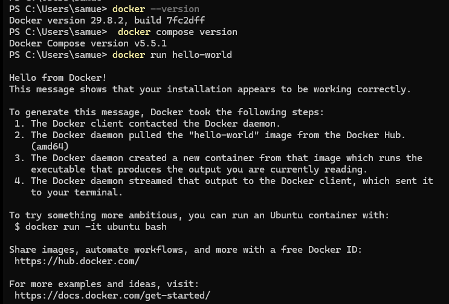
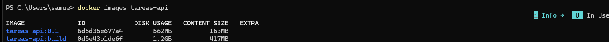
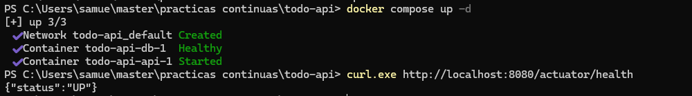
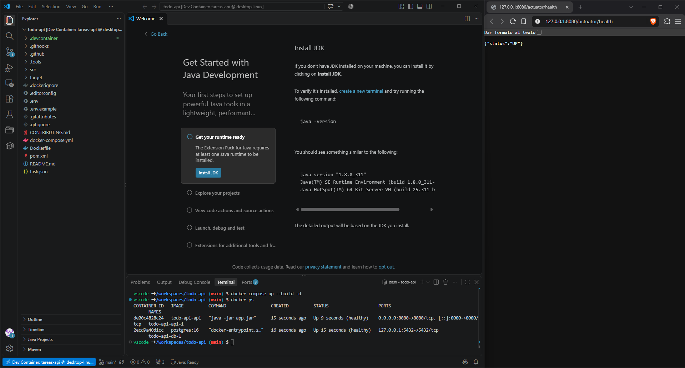
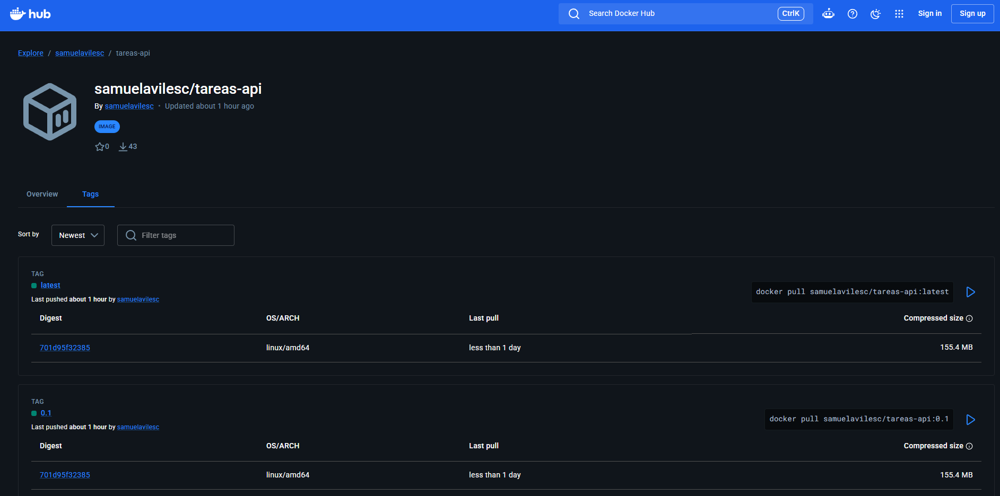
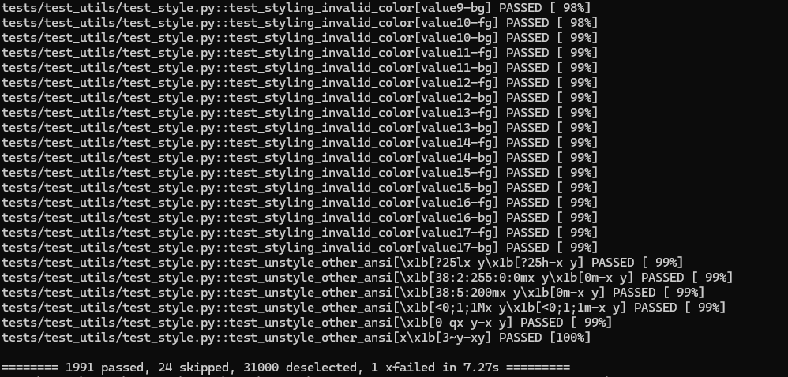

# Boletín 3 — Docker: contenerizar la aplicación

**Autores:** Gloria Sánchez Alonso y Samuel Avilés Conesa
**Repositorio:** https://github.com/samuelavilesc/practicas-continuas-gloriasamu
**Issue:** [#9](https://github.com/samuelavilesc/practicas-continuas-gloriasamu/issues/9) · **Pull Request:** [#10](https://github.com/samuelavilesc/practicas-continuas-gloriasamu/pull/10)

## Introducción

Este boletín parte de la API de tareas del Boletín 2 y la empaqueta en una imagen Docker. La imagen se construye con un Dockerfile multi-stage, se ejecuta sin root y tiene un healthcheck. Además, la API pasa de H2 en memoria a PostgreSQL, levantado con Docker Compose, y las credenciales salen a un fichero `.env` que no se versiona. También se añade un *dev container* para que cualquiera tenga el mismo entorno de desarrollo.

Todos los cambios del repositorio se han hecho en la rama `feat/docker` y han entrado en `main` mediante el PR #10, siguiendo el flujo del `CONTRIBUTING.md`: Issue → rama → PR → revisión cruzada → *squash and merge*. Las Partes A, H e I no modifican el repositorio y se documentan aquí con la salida real de los comandos. Las salidas completas de los comandos están en `logs/` y las capturas de pantalla, en `capturas/`.

En este boletín los commits los ha firmado Samuel aunque se han hecho junto a Gloria y la revisión del PR, Gloria. En el Boletín 4 se invierten los papeles.

## Resumen de commits

Al fusionar con *squash and merge*, todos los commits del PR entran en `main` como uno solo. La tabla recoge ese commit final y los ocho commits de la rama: uno por parte del boletín más una corrección del dev container que salió al probarlo.

| # | Mensaje del commit | Qué se hizo | Autor | Enlace |
|---|--------------------|-------------|-------|--------|
| — | `feat: contenerizar la API con Docker, PostgreSQL y Compose (#10)` | Commit squash en `main` con todo el boletín. | Samuel Avilés Conesa | [c451d50](https://github.com/samuelavilesc/practicas-continuas-gloriasamu/commit/c451d509ad6169394df25f875b90a6c619d390c5) |
| 1 | `feat(actuator): añade endpoint de salud` | Spring Boot Actuator; solo se exponen `health` e `info`. | Samuel Avilés Conesa | [5934de3](https://github.com/samuelavilesc/practicas-continuas-gloriasamu/commit/5934de316be7f36ec8f1a897d1b9367d7e098b5c) |
| 2 | `build(docker): añade Dockerfile multi-stage y .dockerignore` | Imagen en dos etapas, usuario sin privilegios, `HEALTHCHECK`. | Samuel Avilés Conesa | [0dee2a4](https://github.com/samuelavilesc/practicas-continuas-gloriasamu/commit/0dee2a443a14a5304f10c3e2c35f5b14f85f8507) |
| 3 | `feat(db): sustituye H2 por PostgreSQL` | Driver de PostgreSQL en el `pom.xml` y datasource en `application.yml`. | Samuel Avilés Conesa | [bdb4a5e](https://github.com/samuelavilesc/practicas-continuas-gloriasamu/commit/bdb4a5ee24ea8b3ddb5be29cc5a114a0ee7265f2) |
| 4 | `build(compose): añade docker-compose con PostgreSQL` | Servicios `db` y `api`, volumen nombrado, arranque ordenado. | Samuel Avilés Conesa | [be3ea30](https://github.com/samuelavilesc/practicas-continuas-gloriasamu/commit/be3ea3062a3486a0e5d7efc410ad0412692b1e7d) |
| 5 | `chore(config): saca las credenciales de Compose a un fichero .env` | `.env.example` y compose con `${VAR}`. | Samuel Avilés Conesa | [3fc30e9](https://github.com/samuelavilesc/practicas-continuas-gloriasamu/commit/3fc30e9f253952cdba83899fd971f752ae35085e) |
| 6 | `chore(devcontainer): añade entorno de desarrollo reproducible` | `.devcontainer/devcontainer.json`. | Samuel Avilés Conesa | [99ffd3a](https://github.com/samuelavilesc/practicas-continuas-gloriasamu/commit/99ffd3a4966537d63922dc5ea764d6f251e9011a) |
| 7 | `docs(readme): documenta el arranque con Docker y Dev Container` | README y CONTRIBUTING actualizados. | Samuel Avilés Conesa | [1ce5fb0](https://github.com/samuelavilesc/practicas-continuas-gloriasamu/commit/1ce5fb04317a815c7ce08ddccee95af664e03fae) |
| 8 | `fix(devcontainer): fija el JDK 21 y marca el workspace como seguro para git` | Corrige dos fallos detectados al probar el dev container. | Samuel Avilés Conesa | [917d666](https://github.com/samuelavilesc/practicas-continuas-gloriasamu/commit/917d666f64d82675d5e96cc6099df58ae76eb577) |

## Detalle por commit

### 1. `feat(actuator): añade endpoint de salud`
- **Qué se hizo:** se añade la dependencia `spring-boot-starter-actuator` al `pom.xml`. En `application.yml` se exponen solo `health` e `info` y se ocultan los detalles del health a usuarios no autorizados (`show-details: when-authorized`).
- **Autor:** Samuel Avilés Conesa.
- **Relación con el boletín:** Parte B. Es el endpoint que usan el `HEALTHCHECK` del Dockerfile, Compose y, más adelante, el pipeline y el despliegue.


### 2. `build(docker): añade Dockerfile multi-stage y .dockerignore`
- **Qué se hizo:** `Dockerfile` en dos etapas. La primera (`maven:3.9-eclipse-temurin-21`) descarga dependencias y compila; la segunda (`eclipse-temurin:21-jre`) solo lleva el JAR, curl para el healthcheck y un usuario `app` sin privilegios (uid 1001). `.dockerignore` con la lista del boletín y además `.tools/`, porque en local tenemos una distribución de Maven ahí (ignorada por Git) que si no se enviaría al contexto de build.
- **Autor:** Samuel Avilés Conesa.
- **Relación con el boletín:** Parte C.

### 3. `feat(db): sustituye H2 por PostgreSQL`
- **Qué se hizo:** en el `pom.xml` se cambia `com.h2database:h2` por `org.postgresql:postgresql` (scope `runtime`). En `application.yml` se elimina la URL y el driver de H2 y queda `jdbc:postgresql://localhost:5432/tareas` como URL por defecto para arrancar sin Docker. Las credenciales no se escriben: en Compose llegan por las variables `SPRING_DATASOURCE_URL`, `SPRING_DATASOURCE_USERNAME` y `SPRING_DATASOURCE_PASSWORD`, que Spring Boot asocia automáticamente a `spring.datasource.*`. Se mantiene `spring.jpa.hibernate.ddl-auto: update`. Los tests (`TaskServiceTest`, 12 tests) son unitarios y siguen pasando sin base de datos.
- **Autor:** Samuel Avilés Conesa.
- **Relación con el boletín:** Parte D.1.
- **Uso de IA:** Claude Code, con el prompt del boletín: *"Modifica ligeramente el proyecto existente para sustituir la base de datos H2 en memoria por PostgreSQL, manteniendo Spring Data JPA con Hibernate como capa de persistencia"*. Revisamos que no quedara ninguna referencia a H2 (`grep -ri h2 src pom.xml` no devuelve nada).

### 4. `build(compose): añade docker-compose con PostgreSQL`
- **Qué se hizo:** `docker-compose.yml` con dos servicios:
  - `db`: `postgres:16`, volumen `db-data`, puerto publicado solo en `127.0.0.1` y healthcheck con `pg_isready`.
  - `api`: se construye desde el Dockerfile, recibe el datasource por variables de entorno y espera a `db` con `depends_on: condition: service_healthy`.
- **Autor:** Samuel Avilés Conesa.
- **Relación con el boletín:** Parte D.2. Como avisa el boletín, en este commit la contraseña de desarrollo todavía está escrita en el YAML; se corrige en el commit 5.


### 5. `chore(config): saca las credenciales de Compose a un fichero .env`
- **Qué se hizo:** `.env.example` versionado como plantilla y compose reescrito con `${POSTGRES_DB}`, `${POSTGRES_USER}`, `${POSTGRES_PASSWORD:?…}` y `$${…}` en el healthcheck. El `.gitignore` no cambia porque `.env` ya estaba ignorado desde el Boletín 1. El `.env` real solo existe en local.
- **Autor:** Samuel Avilés Conesa.
- **Relación con el boletín:** Parte E.

### 6. `chore(devcontainer): añade entorno de desarrollo reproducible`
- **Qué se hizo:** `.devcontainer/devcontainer.json` con la imagen Java 21, las features de Maven y Docker-in-Docker, los puertos reenviados, `postCreateCommand` y las extensiones de VS Code.
- **Autor:** Samuel Avilés Conesa.
- **Relación con el boletín:** Parte F.

### 7. `docs(readme): documenta el arranque con Docker y Dev Container`
- **Qué se hizo:** el README explica cómo arrancar con Docker (`cp .env.example .env`, `docker compose up --build -d`, comprobación con curl, tabla `down`/`down -v`), con Dev Container y sin Docker. Añade `/actuator/health` a la tabla de endpoints. En `CONTRIBUTING.md`, el paso "Arranca la API" pasa a usar Compose, porque `java -jar` ya no funciona sin un PostgreSQL.
- **Autor:** Samuel Avilés Conesa.
- **Relación con el boletín:** Parte G.

### 8. `fix(devcontainer): fija el JDK 21 y marca el workspace como seguro para git`
- **Qué se hizo:** dos cambios en `devcontainer.json` tras probarlo (ver Parte F):
  - `"version": "21"` en la feature de Java. Sin esa opción, la feature instala la última versión (JDK 25) y la pone por delante del JDK 21 de la imagen en el `PATH`.
  - `git config --global --add safe.directory ${containerWorkspaceFolder}` como primera orden de `postCreateCommand`. Sin ella, git rechaza el repositorio montado (*dubious ownership*) y el `git config core.hooksPath` falla sin avisar.
- **Autor:** Samuel Avilés Conesa.
- **Relación con el boletín:** Parte F.
- **Uso de IA:** Claude Code detectó los dos problemas al revisar la salida de la prueba y propuso la corrección.

## Descripción narrativa de lo hecho en la sesión

### Parte A — Primeros pasos con Docker

Docker Desktop ya estaba instalado. Se comprueban las versiones y se ejecuta la imagen de prueba (`logs/A-hello.txt`):

```text
$ docker --version
Docker version 29.8.2, build 7fc2dff
$ docker compose version
Docker Compose version v5.5.1
$ docker run hello-world
...
Hello from Docker!
This message shows that your installation appears to be working correctly.
```



### Parte B — Endpoint de salud

Con Actuator añadido (commit 1), se arranca la API en local con `java -jar` y se comprueba el endpoint (`logs/B-health.txt`):

```text
$ curl http://localhost:8080/actuator/health
{"status":"UP"}
```

`show-details: when-authorized` hace que un usuario anónimo solo vea `UP`/`DOWN`, sin información interna como el estado del disco o de la base de datos. En el `/actuator` solo se publican `health` e `info`; endpoints como `env` o `heapdump` filtrarían configuración y memoria.

### Parte C — Dockerfile multi-stage

Se construye la imagen y se arranca un contenedor (`logs/C-build-inicial.txt`, `logs/C-run.txt`). El primer build, sin caché, tarda **1 min 4 s**.

```text
$ curl http://localhost:8080/api/tasks
[]
$ docker ps
CONTAINER ID   IMAGE            COMMAND               CREATED         STATUS                   PORTS                    NAMES
77d8849e3364   tareas-api:0.1   "java -jar app.jar"   8 seconds ago   Up 7 seconds (healthy)   0.0.0.0:8080->8080/tcp   tareas-test
$ docker exec tareas-test whoami
app
```

El contenedor llega a `(healthy)` gracias al `HEALTHCHECK`, y `whoami` confirma que la aplicación **no se ejecuta como root**.

**Comparación de tamaños** (`logs/C-tamanos.txt`):

```text
$ docker build --target build -t tareas-api:build .
$ docker images tareas-api
IMAGE              ID             DISK USAGE   CONTENT SIZE
tareas-api:0.1     e2d55f659d39        564MB          164MB
tareas-api:build   0d5e43b1de6f        1.2GB          417MB
```



La imagen de la etapa `build` ocupa más del doble (1,2 GB frente a 564 MB en disco; 417 MB frente a 164 MB comprimidos). La diferencia sale de todo lo que hace falta para **compilar** pero no para **ejecutar**:

- el **JDK** completo (compilador `javac`, `jlink`, herramientas de depuración…) en lugar de solo el **JRE**;
- **Maven** instalado;
- el **repositorio local de Maven** (`~/.m2`) con todas las dependencias y los plugins (Spring Boot, Spotless, Surefire…) descargados por `dependency:go-offline`;
- el código fuente y las clases intermedias de `target/`.

La imagen final solo añade a `eclipse-temurin:21-jre` una capa de 51,5 MB con el JAR (que ya lleva dentro sus dependencias) y unos pocos KB del usuario `app` (`docker history tareas-api:0.1`). Menos tamaño significa también menos superficie de ataque: en producción no hay compilador ni Maven que se puedan explotar.

**Caché de capas** (`logs/C-cache-orden-correcto.txt` y `logs/C-cache-orden-invertido.txt`). En los dos casos se añadió un comentario a `TodoApiApplication.java` antes de reconstruir:

| Orden en el Dockerfile | `dependency:go-offline` | `package` | Tiempo total |
|---|---|---|---|
| `COPY pom.xml` → `go-offline` → `COPY src` (original) | `CACHED` | 5,4 s | **9,7 s** |
| `COPY src` → `COPY pom.xml` → `go-offline` (invertido) | **32,2 s** (se repite) | 5,7 s | **42,1 s** |

Con el orden invertido, primero se hizo un build de calentamiento para que la comparación fuera justa; después se cambió la clase y se midió.

**Explicación:** Docker invalida una capa en cuanto cambia alguna de sus entradas, y con ella todas las siguientes. En el orden original, cambiar una clase solo invalida `COPY src` y las capas posteriores. La capa de `go-offline` depende únicamente del `pom.xml`, que no ha cambiado, así que se reutiliza (`CACHED`) y solo se recompila. Con `COPY src` arriba, cualquier cambio en el código invalida también la capa de dependencias y Maven vuelve a descargar todo desde Maven Central: 32 s extra en cada build. Por eso lo que cambia poco (el `pom.xml`) va arriba y lo que cambia mucho (`src/`), abajo. Tras el experimento, el Dockerfile se dejó en su orden original; el cambio temporal no se commiteó.

### Parte D — De H2 a PostgreSQL con Compose

Tras cambiar el driver (commit 3) y crear el compose (commit 4), se levanta el stack y se prueba la persistencia (`logs/D3-persistencia.txt`):

```text
$ docker compose ps
NAME             IMAGE          SERVICE   STATUS                    PORTS
todo-api-api-1   todo-api-api   api       Up 15 seconds (healthy)   0.0.0.0:8080->8080/tcp
todo-api-db-1    postgres:16    db        Up 21 seconds (healthy)   127.0.0.1:5432->5432/tcp

$ curl -X POST http://localhost:8080/api/tasks -H "Content-Type: application/json" \
    -d '{"title":"Comprobar persistencia","description":"Boletin 3","status":"PENDING","priority":3,"dueDate":"2026-10-12"}'
{"id":1,"title":"Comprobar persistencia","description":"Boletin 3","status":"PENDING","priority":3,"dueDate":"2026-10-12"}

$ docker compose down            # borra contenedores y red
$ docker volume ls | grep todo-api_db-data
local     todo-api_db-data       # el volumen sigue existiendo
$ docker compose up -d
$ curl http://localhost:8080/api/tasks   # el dato sigue ahí
[{"id":1,"title":"Comprobar persistencia",...}]

$ docker compose down -v
 ...
 Volume todo-api_db-data Removed
$ docker compose up -d
$ curl http://localhost:8080/api/tasks   # lista vacía
[]
```




En la captura se ve también para qué sirve el healthcheck. El primer `curl` tras `docker compose up -d` devolvió `curl: (52) Empty reply from server`, porque `docker compose ps` aún mostraba la API como `health: starting`: el contenedor estaba arrancado, pero Spring Boot todavía no aceptaba peticiones. Unos segundos después, con la API ya `healthy`, la misma petición devolvió la tarea. Por eso `depends_on` usa `service_healthy` y no solo "arrancado".

**`down` frente a `down -v`:**
- `docker compose down` para y **elimina los contenedores** (`todo-api-api-1`, `todo-api-db-1`) y la **red** del proyecto (`todo-api_default`). Los **volúmenes nombrados no se tocan**: los ficheros de PostgreSQL siguen en `todo-api_db-data` y, al volver a levantar el stack, el nuevo contenedor de `db` monta el mismo volumen y encuentra los datos.
- `docker compose down -v` hace lo mismo y **además borra los volúmenes nombrados** declarados en el compose. La base de datos desaparece; al volver a arrancar, PostgreSQL inicializa un directorio vacío y la tabla se crea de nuevo vacía (`ddl-auto: update`).

En ningún caso se borran las imágenes. Para eso existe `docker compose down --rmi`.

Mientras `db` no está `healthy`, `depends_on: condition: service_healthy` hace que Compose espere antes de arrancar `api` (en el log: `Container todo-api-db-1 Waiting` → `Healthy` → `todo-api-api-1 Starting`). Así la API no falla al conectar con una base de datos que todavía se está inicializando.

### Parte E — Sacar la configuración a un fichero `.env`

1. Se crea `.env.example` (versionado) y, a partir de él, el `.env` local con `cp .env.example .env`, cambiando la contraseña.
2. `.env` ya estaba en el `.gitignore` desde el Boletín 1 y está en el `.dockerignore` desde la Parte C. Se comprueba (`logs/E-config.txt`):

   ```text
   $ git check-ignore -v .env
   .gitignore:4:.env	.env
   $ grep -n "^.env$" .dockerignore
   9:.env
   ```

   `.env` nunca se había subido al repositorio, así que no hizo falta `git rm --cached` ni cambiar la contraseña.
3. `docker compose config` muestra los valores ya sustituidos (extracto):

   ```yaml
   services:
     api:
       environment:
         SPRING_DATASOURCE_PASSWORD: secret_local_dev
         SPRING_DATASOURCE_URL: jdbc:postgresql://db:5432/tareas
         SPRING_DATASOURCE_USERNAME: app
     db:
       environment:
         POSTGRES_DB: tareas
         POSTGRES_PASSWORD: secret_local_dev
         POSTGRES_USER: app
       healthcheck:
         test:
           - CMD-SHELL
           - pg_isready -U $${POSTGRES_USER} -d $${POSTGRES_DB}
   ```

   Las variables `${…}` se han sustituido por `tareas`, `app` y la contraseña. El healthcheck mantiene `$${…}` porque esa sustitución no la hace Compose: la hace el shell **dentro** del contenedor de PostgreSQL, que tiene esas variables en su entorno.

4. Como prueba extra de `${VAR:?mensaje}`, se movió temporalmente el `.env` y se volvió a ejecutar `docker compose config` (`logs/E-sin-env.txt`):

   ```text
   WARN The "POSTGRES_DB" variable is not set. Defaulting to a blank string.
   ...
   error while interpolating services.db.environment.POSTGRES_PASSWORD: required variable POSTGRES_PASSWORD is missing a value: Define POSTGRES_PASSWORD en el fichero .env
   ```

   Las variables `${VAR}` normales solo dan un aviso y quedan vacías, mientras que `:?` impide arrancar con un mensaje claro.
5. Se levanta el stack desde cero (`logs/E-up.txt`):

   ```text
   $ docker compose down -v
   $ docker compose up --build -d
   $ docker compose ps
   todo-api-api-1   ...   Up 21 seconds (healthy)
   todo-api-db-1    ...   Up 27 seconds (healthy)
   $ curl http://localhost:8080/actuator/health
   {"status":"UP"}
   ```

### Parte F — Dev container

**Qué indica cada campo de `devcontainer.json`:**

| Campo | Qué hace |
|---|---|
| `name` | Nombre del entorno que muestra VS Code (y el contenedor). |
| `image` | Imagen base del contenedor de desarrollo: `mcr.microsoft.com/devcontainers/java:21`, una imagen de Microsoft preparada para dev containers (Debian con JDK 21, git, usuario `vscode` no root, etc.). |
| `features` | Piezas instalables y reutilizables que se aplican sobre la imagen (son paquetes OCI publicados en `ghcr.io`). Cada clave es la feature y su valor, las opciones. |
| `features → java:1` con `installMaven: true` | Gestiona el JDK y, con esa opción, instala también Maven, que la imagen base no trae. |
| `features → docker-in-docker:2` con `moby: false` | Instala Docker Engine, CLI y Compose **dentro** del dev container. `moby: false` usa los paquetes oficiales de Docker CE en lugar de Moby (la versión open source que usan algunas distribuciones). |
| `forwardPorts` | Puertos del contenedor que VS Code reenvía al `localhost` del anfitrión: 8080 (API) y 5432 (PostgreSQL). |
| `postCreateCommand` | Orden que se ejecuta **una sola vez**, al crear el contenedor (no en cada arranque). |
| `customizations.vscode.extensions` | Extensiones que VS Code instala automáticamente dentro del contenedor: el *Extension Pack for Java* y la extensión de Docker. |

**¿Para qué sirve `docker-in-docker`?** El dev container es en sí un contenedor, así que dentro no hay Docker. Pero en este proyecto el flujo de desarrollo es `docker compose up --build`, que necesita un daemon de Docker para construir la imagen y lanzar `api` y `db`. Docker-in-Docker ejecuta un daemon independiente dentro del dev container: las imágenes, contenedores y volúmenes que se creen ahí quedan aislados de los del anfitrión. La alternativa, *docker-outside-of-docker*, montaría el socket del Docker del anfitrión.

**Las tres órdenes de `postCreateCommand`** (separadas por `;`, se ejecutan en orden aunque alguna falle):

1. `test -f .env || cp .env.example .env`: si no existe `.env`, lo crea copiando la plantilla. Sin él, Compose no arrancaría por `${POSTGRES_PASSWORD:?…}`. Si ya existe, no lo sobrescribe.
2. `if [ -d .githooks ]; then git config core.hooksPath .githooks; fi`: si el repositorio tiene la carpeta de hooks versionados, la activa. Así el hook de pre-commit con Spotless (Boletín 1) funciona también dentro del contenedor.
3. `mvn -B dependency:go-offline`: descarga en el contenedor todas las dependencias y plugins de Maven, para que la primera compilación sea rápida y se pueda trabajar sin conexión. `-B` es modo *batch* (sin interacción ni colores).

**Prueba.** Se probó con la CLI oficial de la especificación (`@devcontainers/cli`), que hace lo mismo que *Reopen in Container* de VS Code (`logs/F-devcontainer.txt`):

Primer intento, con el `devcontainer.json` tal cual lo da el boletín: el contenedor se crea y `docker compose up --build` funciona dentro, pero aparecen dos problemas:

```text
$ devcontainer exec --workspace-folder . bash -c "java -version; git config core.hooksPath"
openjdk version "25.0.4" 2026-07-21 LTS        <- debería ser 21
                                               <- vacío: hooks sin activar
$ devcontainer exec --workspace-folder . git status
fatal: detected dubious ownership in repository at '/workspaces/todo-api'
```

- **JDK 25 en lugar de 21:** la imagen `java:21` trae el JDK 21, pero la feature `java:1` sin la opción `version` instala la versión *latest* con sdkman (`25.0.4-tem`), que queda primera en el `PATH`. El proyecto compila con `java.version=21` y funcionaría igual, pero no es el entorno que se pretende fijar.
- **Hooks sin activar:** en Windows (y en general con *bind mounts*), los ficheros del workspace aparecen como propiedad de `root` y el usuario del contenedor es `vscode`. Desde la versión 2.35.2, git se niega a operar en repositorios de otro usuario. La segunda orden de `postCreateCommand` falla y, como las órdenes van separadas por `;` y no por `&&`, el error pasa desapercibido.

Se corrigió en el commit 8 (`"version": "21"` y `safe.directory`). Después se volvió a probar desde cero, quitando temporalmente el `.env` del host para comprobar también la primera orden (`logs/F-devcontainer.txt`):

```text
$ devcontainer up --workspace-folder .
Running the postCreateCommand from devcontainer.json...
[INFO] BUILD SUCCESS                                   <- mvn dependency:go-offline
{"outcome":"success",...,"remoteUser":"vscode","remoteWorkspaceFolder":"/workspaces/todo-api"}

$ devcontainer exec --workspace-folder . bash -c "java -version; mvn -v; docker --version; cat .env; git config core.hooksPath"
openjdk version "21.0.12.1" 2026-08-18 LTS
Apache Maven 3.10.0
Docker version 29.8.2, build 7fc2dff
Docker Compose version v2.40.3
# Copia este fichero a .env y ajusta los valores    <- creado desde .env.example
POSTGRES_DB=tareas
POSTGRES_USER=app
POSTGRES_PASSWORD=cambia_esto
.githooks                                           <- hook activado

$ devcontainer exec --workspace-folder . docker compose up --build -d
 Container todo-api-db-1  Healthy
 Container todo-api-api-1  Started
$ devcontainer exec --workspace-folder . docker compose ps
todo-api-api-1   ...   Up 19 seconds (healthy)   0.0.0.0:8080->8080/tcp
todo-api-db-1    ...   Up 24 seconds (healthy)   127.0.0.1:5432->5432/tcp
$ (dentro del dev container) curl http://127.0.0.1:8080/actuator/health
{"status":"UP"}
```

Las tres órdenes de `postCreateCommand` (más la nueva de `safe.directory`) funcionan, y el stack completo corre con el Docker *interno* del dev container (Docker-in-Docker). La CLI no reenvía puertos: eso lo hace VS Code con `forwardPorts`. La comprobación desde el navegador del anfitrión hay que hacerla con *Reopen in Container* en VS Code.

**Prueba en VS Code.** Con la extensión *Dev Containers* y *Reopen in Container*, el primer intento falló al arrancar el contenedor, después de construir la imagen. El log de la extensión mostraba:

```text
docker: Error response from daemon: accessing specified distro mount service:
stat /run/guest-services/distro-services/ubuntu.sock: no such file or directory
```

El `docker run` que lanza VS Code incluía un montaje que no está en nuestro `devcontainer.json`:

```text
--mount type=bind,src=\\wsl.localhost\Ubuntu\mnt\wslg\runtime-dir\wayland-0,dst=/tmp/vscode-wayland-....sock
```

En Windows, la extensión monta por defecto el socket de **Wayland** de WSLg, el servidor gráfico de WSL, desde la distro `Ubuntu` instalada en el equipo. Así, las aplicaciones gráficas Linux del contenedor podrían mostrarse en Windows. Docker Desktop no tenía activada la integración con esa distro (*Settings → Resources → WSL integration*), así que no podía acceder a su sistema de ficheros y el contenedor no llegaba a arrancar. La CLI `devcontainer` no añade ese montaje, y por eso la prueba anterior había funcionado.

No es un problema del proyecto sino de la configuración local de VS Code. Por eso **no se modificó el repositorio**: se desactivó en VS Code el ajuste *Dev › Containers: Mount Wayland Socket* (`dev.containers.mountWaylandSocket: false`), porque este proyecto no necesita aplicaciones gráficas. La otra opción era activar la integración WSL de Docker Desktop con `Ubuntu`. Después, *Dev Containers: Rebuild and Reopen in Container* arrancó correctamente.

Es un buen ejemplo de los límites de un dev container: el entorno *dentro* del contenedor es reproducible, pero la herramienta que lo arranca (VS Code, Docker Desktop, WSL) sigue dependiendo de cada máquina.

Resultado en VS Code: abajo a la izquierda, `Dev Container: tareas-api`. En el terminal del contenedor (`vscode → /workspaces/todo-api`), `docker compose up --build -d` deja `api` y `db` en `(healthy)`. La pestaña *Ports* muestra los puertos reenviados, y el **navegador de Windows** abre `http://127.0.0.1:8080/actuator/health` con `{"status":"UP"}` gracias a `forwardPorts`, aunque la API corre en el Docker interno del dev container.



### Parte G — Versionar los cambios

Se siguió el flujo de `CONTRIBUTING.md`:

1. [Issue #9](https://github.com/samuelavilesc/practicas-continuas-gloriasamu/issues/9) "[feat] Contenerizar la API con Docker y PostgreSQL" con la plantilla `enhancement` y los criterios de aceptación.
2. Rama `feat/docker` desde `main`, con un commit por parte del boletín y la corrección del dev container (tabla de arriba).
3. [PR #10](https://github.com/samuelavilesc/practicas-continuas-gloriasamu/pull/10), con la plantilla, `Closes #9`, la descripción de cómo se probó y notas para la revisión. Gloria aparece como revisora.
4. Al probar el dev container apareció el commit de corrección 8. Se añadió al PR con un comentario explicando el motivo, para que Gloria lo tuviera en cuenta al revisar.
5. **Revisión:** Gloria revisó el PR y lo **aprobó** sin pedir cambios (5 de octubre, 11:34). Con la aprobación se cumple la regla de protección de `main` (1 aprobación requerida).
6. **Fusión:** *squash and merge* el 5 de octubre a las 11:39, como commit [`c451d50`](https://github.com/samuelavilesc/practicas-continuas-gloriasamu/commit/c451d509ad6169394df25f875b90a6c619d390c5). El Issue #9 se cerró automáticamente gracias a `Closes #9`.

El PR incluye todo lo que pide el boletín: `Dockerfile`, `.dockerignore`, `docker-compose.yml`, `.env.example`, `pom.xml`, `application.yml`, `.devcontainer/devcontainer.json`, `README.md` y además `CONTRIBUTING.md`. El `.gitignore` no aparece porque ya contenía `.env`.

### Parte H — Registry de Docker (Docker Hub)

Esta parte no toca el repositorio: solo se publica en Docker Hub la imagen construida en la Parte C (ya con PostgreSQL y Actuator). Resultado: **https://hub.docker.com/r/samuelavilesc/tareas-api** (`logs/H-push.txt`, `logs/H-verificacion.txt`).

**Pasos seguidos:**

1. **Cuenta y token.** Con la cuenta `samuelavilesc` de Docker Hub, se crea un *Personal Access Token* (Account settings → Personal access tokens) con permiso *Read & Write*. Es mejor que la contraseña porque se puede revocar sin cambiarla y tiene permisos limitados.
2. **Login.** `docker login -u samuelavilesc` pide el token de forma interactiva.
3. **Etiquetar.** El nombre de una imagen en Docker Hub es `<usuario>/<repositorio>:<tag>`. La imagen local `tareas-api:0.1` se etiqueta con ese formato. Una etiqueta es solo otro nombre para la misma imagen (mismo ID):

   ```text
   $ docker tag tareas-api:0.1 samuelavilesc/tareas-api:0.1
   $ docker tag tareas-api:0.1 samuelavilesc/tareas-api:latest
   $ docker images samuelavilesc/tareas-api
   IMAGE                             ID             DISK USAGE   CONTENT SIZE
   samuelavilesc/tareas-api:0.1      6d5d35e677a4        562MB          163MB
   samuelavilesc/tareas-api:latest   6d5d35e677a4        562MB          163MB
   ```

4. **Subir.** `docker push` crea el repositorio automáticamente (público por defecto) y sube las capas:

   ```text
   $ docker push samuelavilesc/tareas-api:0.1
   The push refers to repository [docker.io/samuelavilesc/tareas-api]
   44136fa355b3: Mounted from grafana/k6
   06ad70e463aa: Pushed
   ...
   4f4fb700ef54: Mounted from n8nio/n8n
   0.1: digest: sha256:6d5d35e677a4c396440f9983af844e25a134e81ae7cf8794b251566b7ab43653 size: 856
   $ docker push samuelavilesc/tareas-api:latest
   4e07a0f12b2c: Layer already exists
   ...
   latest: digest: sha256:6d5d35e677a4c396440f9983af844e25a134e81ae7cf8794b251566b7ab43653 size: 856
   ```

   Aquí también se ven las capas en acción. Las que ya existían en Docker Hub (la base de Ubuntu de `eclipse-temurin`, compartida con otras imágenes públicas) no se suben: se **montan** desde ellas (`Mounted from …`). El segundo push no sube nada (`Layer already exists`), porque `latest` y `0.1` son la misma imagen con el mismo *digest*.
5. **Verificar.** Se consulta la API pública de Docker Hub, se borra la imagen local y se vuelve a descargar:

   ```text
   $ curl -s https://hub.docker.com/v2/repositories/samuelavilesc/tareas-api/tags
   latest sha256:6d5d35e6... 163.0 MB
   0.1    sha256:6d5d35e6... 163.0 MB
   $ docker rmi samuelavilesc/tareas-api:0.1 && docker pull samuelavilesc/tareas-api:0.1
   docker.io/samuelavilesc/tareas-api:0.1
   ```

6. **Comprobar que no se ha publicado nada sensible.** La imagen es pública, así que se revisa qué contiene `/app`:

   ```text
   $ docker run --rm --entrypoint ls samuelavilesc/tareas-api:0.1 -la /app
   -rw-r--r-- 1 root root 50217893 Oct  5 10:28 app.jar
   ```

   Solo está el JAR: ni código fuente, ni `.env`, ni `.git`. Lo garantizan el multi-stage (solo se copia `app.jar` de la etapa de build) y el `.dockerignore` (`.env` ni siquiera entra al contexto de build). Las credenciales de la base de datos tampoco están en la imagen: llegan en tiempo de ejecución como variables de entorno.

Cualquiera puede ahora levantar la API sin clonar ni compilar, cambiando en el compose `build: .` por `image: samuelavilesc/tareas-api:0.1`. En el Boletín 5 este proceso (tag + push) lo automatizará el pipeline de CD.



Docker Hub muestra el digest `701d95f32385` y no el `6d5d35e6…` que devolvió `docker push`. No es otra imagen. El push devuelve el digest del **índice** (la lista de manifiestos que puede agrupar varias arquitecturas, y que BuildKit genera por defecto), mientras que Hub muestra el del **manifiesto** de la plataforma concreta, `linux/amd64`. Tampoco hay discrepancia de tamaño: 155,4 en Hub y 163 MB en local son la misma cifra en MiB (2²⁰ bytes) y en MB (10⁶ bytes).

### Parte I — Entorno de pruebas reproducible

#### 1. Repositorio elegido

**[pallets/click](https://github.com/pallets/click)**, la librería de Python para crear interfaces de línea de comandos (17,8k estrellas). La usan Flask, Black, pip-tools y miles de proyectos más, y tiene una batería de **más de 2000 tests** en pytest. Se fija el **tag `8.5.0`** (último release) para que el resultado sea reproducible.

#### 2. Análisis de requisitos

| Requisito | Valor | Fuente |
|---|---|---|
| Lenguaje | Python | `pyproject.toml` |
| Versión de Python | `>=3.10`; el CI prueba 3.10, 3.11, 3.12, 3.13, 3.14, 3.14t y PyPy 3.11 | `requires-python` en `pyproject.toml`; matriz en `.github/workflows/tests.yaml` |
| Gestor de paquetes | **uv**, con lockfile `uv.lock` | `uv.lock`, `[tool.uv]` en `pyproject.toml`; el CI usa `astral-sh/setup-uv` y `uv run --locked` |
| Orquestador de tests | tox con `tox-uv` (`runner = "uv-venv-lock-runner"`) | `[tool.tox]` en `pyproject.toml` |
| Build backend | `flit_core>=3.11,<4` | `[build-system]` en `pyproject.toml` |
| Dependencias de tests | grupo `tests` = `pytest` (click no tiene dependencias de ejecución en Linux) | `[dependency-groups]` en `pyproject.toml` |
| Orden de tests | `pytest -v --tb=short`, `testpaths = ["tests"]`, `-m 'not stress'` por defecto y `filterwarnings = error` | `[tool.tox.env_run_base]` y `[tool.pytest.ini_options]` |
| Dependencias del sistema | **`less`**: no se ve en ningún fichero de configuración; se descubrió al ejecutar (ver punto 4) | `tests/test_utils/test_echo_via_pager.py` |

No usamos tox dentro del contenedor: el contenedor ya es el entorno aislado, y tox solo añadiría crear otro venv. Ejecutamos lo mismo que ejecuta tox (`pytest -v --tb=short` con las dependencias bloqueadas en `uv.lock`).

#### 3. Dockerfile

Está en `parte-i/Dockerfile`, fuera del repositorio de la API:

```dockerfile
# Entorno reproducible para ejecutar los tests de pallets/click (tag 8.5.0).
# Contexto de build: un clon del repositorio. Solo se copian pyproject.toml y
# uv.lock para preinstalar las dependencias; el código se monta en /src al
# ejecutar el contenedor.

# Misma versión que la primera fila de la matriz de CI (.github/workflows/tests.yaml)
FROM python:3.14-slim

# uv: gestor de paquetes que usa el proyecto (uv.lock, tox-uv). Versión fijada.
COPY --from=ghcr.io/astral-sh/uv:0.9 /uv /uvx /usr/local/bin/

# Dependencia del sistema: tests/test_utils/test_echo_via_pager.py usa 'less'
# como paginador. Viene en los runners ubuntu-latest del CI, pero no en -slim.
RUN apt-get update \
    && apt-get install -y --no-install-recommends less \
    && rm -rf /var/lib/apt/lists/*

# El entorno virtual vive fuera de /src para que el volumen montado no lo tape
# ni ensucie el directorio del host.
ENV UV_PROJECT_ENVIRONMENT=/opt/venv \
    UV_LINK_MODE=copy \
    UV_PYTHON_DOWNLOADS=never \
    PYTHONDONTWRITEBYTECODE=1

# Usuario sin privilegios: algunos tests comprueban permisos de ficheros y
# root se los saltaría (root puede leer ficheros con chmod 000).
RUN useradd --create-home --uid 1001 tester \
    && mkdir -p /opt/venv /src && chown tester:tester /opt/venv /src
USER tester
WORKDIR /src

# Capa de dependencias: solo cambia si cambia el lockfile.
COPY --chown=tester:tester pyproject.toml uv.lock ./
RUN uv sync --locked --no-install-project --no-default-groups --group tests

# Al arrancar: instala click (editable) desde el código montado y lanza pytest
# con las mismas opciones que tox en CI. -p no:cacheprovider evita escribir
# .pytest_cache en el directorio del host.
CMD ["sh", "-c", "uv sync --locked --no-default-groups --group tests && uv run --no-sync pytest -v --tb=short -p no:cacheprovider"]
```

Decisiones:
- **`python:3.14-slim`**: la versión principal del CI, en variante *slim* para que la imagen sea pequeña (283 MB).
- **uv con `--locked`**: instala exactamente las versiones de `uv.lock`, y falla si el lockfile no corresponde con `pyproject.toml`. Es lo que hace reproducible el entorno.
- **La misma idea de capas que en la Parte C**: primero solo `pyproject.toml` y `uv.lock`, y se instalan las dependencias; el código no se copia, se monta. Cambiar el código no obliga a reconstruir la imagen, solo a volver a ejecutarla.
- **Venv en `/opt/venv`**: si estuviera en `/src/.venv`, el volumen montado lo taparía y además crearía un `.venv` de Linux en la carpeta del host.
- **Usuario no root**, por la misma razón que en la API y porque algunos tests de permisos de ficheros dan resultados falsos como root.

#### 4. Construcción y ejecución

```bash
git clone https://github.com/pallets/click.git
cd click && git checkout 8.5.0
docker build -t click-tests:8.5.0 -f ../parte-i/Dockerfile .
docker run --rm -v "$(pwd):/src" click-tests:8.5.0
```

El código fuente se monta con `-v "$(pwd):/src"`: el contenedor ejecuta los tests sobre el código del host, sin copiarlo en la imagen.

**Primer intento, sin `less`** (`logs/I-run-sin-less.txt`):

```text
FAILED tests/test_utils/test_echo_via_pager.py::test_echo_via_pager[test0-less]
...
E   AssertionError: Unexpected pager output in test case 'Plain string argument'
=== 24 failed, 1967 passed, 24 skipped, 31000 deselected, 1 xfailed in 9.74s ===
```

Fallaban los 24 casos de `test_echo_via_pager` parametrizados con `"less"` como paginador (`pager_cmd` en `["cat", "cat ", " cat ", "less", " less", " less "]`). Los de `cat` pasaban. La imagen *slim* no incluye `less`, mientras que los runners `ubuntu-latest` de GitHub Actions sí. Es una **dependencia de sistema implícita**, que no aparece en ningún fichero de configuración del proyecto. Por eso tiene valor un Dockerfile que la deje escrita.

**Con `less` instalado** (`logs/I-build.txt`, `logs/I-run.txt`):

```text
$ docker run --rm -v "$(pwd):/src" click-tests:8.5.0
Resolved 81 packages in 3ms
      Built click @ file:///src
 + click==8.5.0 (from file:///src)
============================= test session starts ==============================
platform linux -- Python 3.14.8, pytest-9.0.2, pluggy-1.6.0 -- /opt/venv/bin/python
rootdir: /src
configfile: pyproject.toml
testpaths: tests
...
======== 1991 passed, 24 skipped, 31000 deselected, 1 xfailed in 9.25s =========
exit code: 0
```

**Todos los tests pasan.** Lo que no se ejecuta es esperado en el proyecto, no un fallo del entorno:
- **24 skipped**: tests marcados para otras plataformas (por ejemplo, `test_getchar_windows_*` solo en Windows).
- **31000 deselected**: los tests de estrés (`-m stress`), que el propio `pyproject.toml` excluye por defecto con `addopts = "-m 'not stress'"`. En CI tienen un entorno de tox aparte.
- **1 xfailed**: un test marcado por el proyecto como fallo esperado.



Después de ejecutar, `git status` en el clon de click sigue limpio: el contenedor no deja ficheros en el código montado.

## Uso de IA

Hemos usado **Claude Code** (modelo Claude Opus 5.5) en VS Code / terminal para:
- leer el boletín y planificar el trabajo y la estructura de esta memoria;
- aplicar los cambios del repositorio de la migración de H2 a PostgreSQL con el prompt de la Parte D.1;
- ejecutar las pruebas (build, caché, tamaños, persistencia, `.env`, dev container) y guardar su salida en `logs/`;
- elegir el repositorio de la Parte I, analizar sus requisitos y escribir su Dockerfile;


Todo se ha revisado antes de incorporarlo.
