# Boletín 4 — Integración Continua con GitHub Actions

**Autores:** Gloria Sánchez Alonso y Samuel Avilés Conesa
**Repositorio:** https://github.com/samuelavilesc/practicas-continuas-gloriasamu
**Issue:** [#12](https://github.com/samuelavilesc/practicas-continuas-gloriasamu/issues/12) · **Pull Requests:** [#13](https://github.com/samuelavilesc/practicas-continuas-gloriasamu/pull/13) (CI), [#14](https://github.com/samuelavilesc/practicas-continuas-gloriasamu/pull/14) (prueba de la Parte D, sin fusionar) y [#15](https://github.com/samuelavilesc/practicas-continuas-gloriasamu/pull/15) (badge)

## Introducción

Este boletín añade Integración Continua a la API de tareas del Boletín 3. Cada push y cada Pull Request lanzan en GitHub Actions un pipeline que comprueba el formato con Spotless, compila, ejecuta los tests, publica el informe JUnit y genera el JAR. Después, el CI se convierte en una barrera: `main` no acepta un PR cuyos checks no estén en verde. Como ampliación, un segundo workflow pide a una IA de Ollama Cloud un resumen de cada PR y lo publica como comentario. El token de la IA se guarda en un secreto del repositorio.

Casi todos los cambios del repositorio se han hecho en la rama `feat/ci-github-actions` y han entrado en `main` mediante el PR #13, siguiendo el flujo del `CONTRIBUTING.md`: Issue → rama → PR → revisión cruzada → *squash and merge*. Las Partes B y C incluyen commits que rompen el CI a propósito y otros que lo arreglan, para ver el pipeline en rojo y en verde en el propio PR. La Parte D se verifica con un PR aparte (#14) que no se llega a fusionar. El badge del README entró después en el PR #15, que además corrigió un problema del `paths-ignore` que apareció precisamente al activar la Parte D. Las salidas completas de los comandos y de las ejecuciones están en `logs/` y las capturas de pantalla, en `capturas/`.

En este boletín se invierten los papeles respecto al Boletín 3: los commits los ha firmado Gloria y la revisión de los PR la ha hecho Samuel.

## Resumen de commits

Al fusionar con *squash and merge*, todos los commits de un PR entran en `main` como uno solo. La tabla recoge los commits finales de `main` y los commits de las ramas: uno o dos por parte del boletín, los que rompen el CI a propósito con su arreglo y dos correcciones que salieron al probarlo.

| # | Mensaje del commit | Qué se hizo | Autor | Enlace |
|---|--------------------|-------------|-------|--------|
| — | `ci: integración continua con GitHub Actions (#13)` | Commit squash en `main` con los commits 1 a 9. | Gloria Sánchez Alonso | [312f2c1](https://github.com/samuelavilesc/practicas-continuas-gloriasamu/commit/312f2c1ad953256f1e1ebbf1adcf598d83c0a33a) |
| — | `docs(readme): añade el badge del estado del CI (#15)` | Commit squash en `main` con los commits 10 y 11. | Gloria Sánchez Alonso | [8946e80](https://github.com/samuelavilesc/practicas-continuas-gloriasamu/commit/8946e80fc7da4818239c02b249ff7834a0e60d9b) |
| 1 | `ci: añade workflow de integración continua con GitHub Actions` | `ci.yml` con un job `build`; se dispara en push a cualquier rama, PR y a mano. | Gloria Sánchez Alonso | [31d08dc](https://github.com/samuelavilesc/practicas-continuas-gloriasamu/commit/31d08dcf1174e5438129645cc367655c6df5ddfe) |
| 2 | `test: rompe a propósito la aserción de creación de tareas` | Aserción cambiada para que el test falle. | Gloria Sánchez Alonso | [d4e8c85](https://github.com/samuelavilesc/practicas-continuas-gloriasamu/commit/d4e8c85d79625e0abead2aef63e5edc6bd44c66c) |
| 3 | `test: restaura la aserción de creación de tareas` | Se deshace el cambio y el CI vuelve a verde. | Gloria Sánchez Alonso | [6e5b8cc](https://github.com/samuelavilesc/practicas-continuas-gloriasamu/commit/6e5b8cc3dacb6bd64cfc280eeadf3bba3e4df87e) |
| 4 | `ci: separa el workflow en los jobs lint, test y package` | Tres jobs encadenados con `needs`, informe JUnit y JAR como artefacto. | Gloria Sánchez Alonso | [7fe99b9](https://github.com/samuelavilesc/practicas-continuas-gloriasamu/commit/7fe99b984ec0a89efac419917b6ecd5963bc6f49) |
| 5 | `fix(ci): publica el informe JUnit como check run` | `use-actions-summary: "false"` en `dorny/test-reporter`. | Gloria Sánchez Alonso | [24cd3b6](https://github.com/samuelavilesc/practicas-continuas-gloriasamu/commit/24cd3b6cdd619abc6a78fc4418590c12c37022df) |
| 6 | `style: desordena a propósito TaskNotFoundException` | Clase mal formateada, commit con `--no-verify`. | Gloria Sánchez Alonso | [e7766d3](https://github.com/samuelavilesc/practicas-continuas-gloriasamu/commit/e7766d372e11da5d320d5d996b0a1d82a3bb36bf) |
| 7 | `style: restaura el formato de TaskNotFoundException` | Vuelve el formato de Spotless; `lint` en verde. | Gloria Sánchez Alonso | [e205e44](https://github.com/samuelavilesc/practicas-continuas-gloriasamu/commit/e205e4493849e25c7a865404b3d8f7a48b8261a8) |
| 8 | `ci: no ejecuta el CI cuando solo cambia el README` | `paths-ignore: [ "README.md" ]` en push y pull_request. | Gloria Sánchez Alonso | [ea6c495](https://github.com/samuelavilesc/practicas-continuas-gloriasamu/commit/ea6c495433625ab6a095c616a0521518ee769bd7) |
| 9 | `ci: añade resumen de cambios con IA en cada pull request` | Workflow `ai-summary.yml` con Ollama Cloud y el secreto `OLLAMA_API_KEY`. | Gloria Sánchez Alonso | [8b992c4](https://github.com/samuelavilesc/practicas-continuas-gloriasamu/commit/8b992c4967d2e3f7c182779fd1b4ee779541d907) |
| 10 | `docs(readme): añade el badge del estado del CI` | Badge del workflow `CI` en el README (PR #15). | Gloria Sánchez Alonso | [21fd9a4](https://github.com/samuelavilesc/practicas-continuas-gloriasamu/commit/21fd9a48a780f26eddc77073593b61290531caeb) |
| 11 | `fix(ci): ejecuta el CI en los PR aunque solo cambie el README` | `paths-ignore` solo en `push` (PR #15). | Gloria Sánchez Alonso | [63c4ce3](https://github.com/samuelavilesc/practicas-continuas-gloriasamu/commit/63c4ce3b67a764587260cd6a0ab5c7fe288b6f41) |

## Detalle por commit

### 1. `ci: añade workflow de integración continua con GitHub Actions`
- **Qué se hizo:** se crea `.github/workflows/ci.yml` con el contenido del boletín (`concurrency`, `permissions: contents: read`, un job `build` en `ubuntu-latest` con JDK 21 Temurin, caché de Maven y `mvn --batch-mode verify`). El disparador `on` se amplía: `push` a cualquier rama (`branches: [ "**" ]`) en lugar de solo `main`, y `workflow_dispatch` para lanzarlo a mano.
- **Autor:** Gloria Sánchez Alonso.
- **Relación con el boletín:** Parte A.

### 2. `test: rompe a propósito la aserción de creación de tareas`
- **Qué se hizo:** en `TaskServiceTest.creaUnaTareaCuandoElTituloEsUnico` se cambia `isEqualTo(TaskStatus.PENDING)` por `isEqualTo(TaskStatus.COMPLETED)`.
- **Autor:** Gloria Sánchez Alonso.
- **Relación con el boletín:** Parte B.

### 3. `test: restaura la aserción de creación de tareas`
- **Qué se hizo:** se deshace el cambio anterior. El diff de la rama contra `main` en `src/` queda vacío.
- **Autor:** Gloria Sánchez Alonso.
- **Relación con el boletín:** Parte B.

### 4. `ci: separa el workflow en los jobs lint, test y package`
- **Qué se hizo:** el job `build` se sustituye por los tres jobs del boletín, encadenados con `needs`. Se mantienen los disparadores de la Parte A. Además de lo que da el boletín:
  - el job `test` declara `permissions: contents: read, checks: write`, porque el informe de tests crea un *check run* y el permiso global del workflow es solo de lectura. Se da solo a ese job y no a todo el workflow;
  - `package` lleva `timeout-minutes: 10`, igual que `lint`, para que ningún job quede sin límite.
- **Autor:** Gloria Sánchez Alonso.
- **Relación con el boletín:** Parte C.

### 5. `fix(ci): publica el informe JUnit como check run`
- **Qué se hizo:** se añade `use-actions-summary: "false"` al paso de `dorny/test-reporter@v1` (ver Parte C).
- **Autor:** Gloria Sánchez Alonso.
- **Relación con el boletín:** Parte C.

### 6. `style: desordena a propósito TaskNotFoundException`
- **Qué se hizo:** la clase se reescribe sin la línea en blanco tras el `package`, sin espacios alrededor de `{` y `+` y con el constructor en una sola línea mal sangrada. Se hace el commit con `git commit --no-verify` para saltar el hook de pre-commit de Spotless del Boletín 1.
- **Autor:** Gloria Sánchez Alonso.
- **Relación con el boletín:** Parte C.

### 7. `style: restaura el formato de TaskNotFoundException`
- **Qué se hizo:** se recupera la versión anterior del fichero (`git checkout HEAD~1 -- …`), que ya cumplía el formato.
- **Autor:** Gloria Sánchez Alonso.
- **Relación con el boletín:** Parte C.

### 8. `ci: no ejecuta el CI cuando solo cambia el README`
- **Qué se hizo:** `paths-ignore: [ "README.md" ]` en los eventos `push` y `pull_request` de `ci.yml`.
- **Autor:** Gloria Sánchez Alonso.
- **Relación con el boletín:** Parte E.

### 9. `ci: añade resumen de cambios con IA en cada pull request`
- **Qué se hizo:** nuevo workflow `.github/workflows/ai-summary.yml`. En cada PR (`opened`, `reopened`, `synchronize`) calcula el diff entre la base y la cabeza del PR, lo envía a la API de chat de Ollama Cloud con el modelo `gpt-oss:120b` y publica la respuesta como comentario. El token se lee de `secrets.OLLAMA_API_KEY`. Si falta el secreto, falla la llamada o la respuesta viene vacía, el comentario es exactamente "La IA ha fallado".
- **Autor:** Gloria Sánchez Alonso.
- **Relación con el boletín:** Parte E (gestión de secretos).

### 10. `docs(readme): añade el badge del estado del CI`
- **Qué se hizo:** badge `actions/workflows/ci.yml/badge.svg?branch=main` bajo el título del README, enlazado a la página del workflow. Va en un PR aparte (#15) porque el PR #13 ya estaba aprobado y, en este repositorio, las aprobaciones caducan con cada commit nuevo.
- **Autor:** Gloria Sánchez Alonso.
- **Relación con el boletín:** Parte E.

### 11. `fix(ci): ejecuta el CI en los PR aunque solo cambie el README`
- **Qué se hizo:** se quita `paths-ignore` del evento `pull_request` y se deja solo en `push`, con un comentario en `ci.yml` que explica por qué (ver Parte E).
- **Autor:** Gloria Sánchez Alonso.
- **Relación con el boletín:** Partes D y E.

## Descripción narrativa de lo hecho en la sesión

### Parte A — Primer pipeline de CI

Tras crear el [Issue #12](https://github.com/samuelavilesc/practicas-continuas-gloriasamu/issues/12) con la plantilla `enhancement`, se crea la rama `feat/ci-github-actions`, se añade `ci.yml` (commit 1) y se abre el [PR #13](https://github.com/samuelavilesc/practicas-continuas-gloriasamu/pull/13). El push y la apertura del PR lanzan dos ejecuciones, y las dos terminan en verde (`logs/A-ci-pr.txt`, `logs/A-ci-push.txt`):

```text
$ gh run list
completed  success  ci: integración continua con GitHub Actions                 CI  feat/ci-github-actions  pull_request  37s
completed  success  ci: añade workflow de integración continua con GitHub Actions  CI  feat/ci-github-actions  push          41s

build  Construir y testear  [INFO] Tests run: 13, Failures: 0, Errors: 0, Skipped: 0
build  Construir y testear  [INFO] BUILD SUCCESS
build  Construir y testear  [INFO] Total time:  18.719 s
```

**¿Para qué sirve `concurrency`?** Agrupa las ejecuciones por la clave `ci-${{ github.ref }}`, es decir, por rama (`refs/heads/<rama>`) o por PR (`refs/pull/<n>/merge`). En un mismo grupo solo puede haber una ejecución en marcha, y con `cancel-in-progress: true`, cuando llega una nueva se cancela la anterior. Si se hacen varios push seguidos a la misma rama, solo importa el resultado del último commit: no tiene sentido gastar minutos de runner en validar uno que ya está obsoleto, y además el feedback del bueno llega antes. Como las ramas tienen grupos distintos, el trabajo de una no cancela el de otra.

Para comprobarlo se lanzó el workflow a mano dos veces seguidas sobre la misma rama (`logs/A-concurrency.txt`):

```text
$ gh workflow run CI --ref feat/ci-github-actions   # dos veces, con 8 s de diferencia
completed  success    CI  feat/ci-github-actions  workflow_dispatch  46s
completed  cancelled  CI  feat/ci-github-actions  workflow_dispatch  26s

X Canceling since a higher priority waiting request for ci-refs/heads/feat/ci-github-actions exists
```

La primera ejecución se canceló en cuanto llegó la segunda, del mismo grupo `ci-refs/heads/feat/ci-github-actions`. Las ejecuciones de `push` y de `pull_request` del mismo commit no se cancelan entre sí, porque su `github.ref` es distinto.

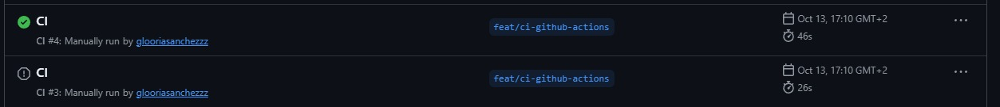

**¿Cuándo se dispara el workflow?** Con el `on` del boletín, solo en dos casos:
- **`push` a `main`**: al fusionar un PR o al hacer push directo, si estuviera permitido.
- **`pull_request`**: con los tipos por defecto `opened`, `synchronize` (nuevo push a la rama del PR) y `reopened`. Se ejecuta sobre el *merge commit* de prueba entre la rama y `main`.

Por tanto, un push a una rama que todavía no tiene PR no lanza nada, y no hay forma de lanzarlo a mano. Para que se dispare en todas las ocasiones se cambió a:

```yaml
on:
  push:
    branches: [ "**" ]     # cualquier rama, no solo main
  pull_request:
  workflow_dispatch:       # botón "Run workflow" en la pestaña Actions
```

`"**"` incluye también las ramas con `/`, como `feat/ci-github-actions` (`"*"` no las incluiría). El precio es que cada push a una rama con PR abierto lanza dos ejecuciones, la de `push` y la de `pull_request`, como se ve arriba.

### Parte B — Demostrar que el CI atrapa errores

En la rama del PR se rompe un test a propósito (commit 2): la creación de una tarea `PENDING` se comprueba contra `COMPLETED`. El check del PR se pone en rojo (`logs/B-ci-rojo.txt`):

```text
[ERROR] Tests run: 13, Failures: 1, Errors: 0, Skipped: 0, Time elapsed: 1.222 s <<< FAILURE! -- in es.practicascontinuas.todo.task.TaskServiceTest
[ERROR] es.practicascontinuas.todo.task.TaskServiceTest.creaUnaTareaCuandoElTituloEsUnico -- Time elapsed: 0.019 s <<< FAILURE!
expected: COMPLETED
 but was: PENDING
[ERROR] BUILD FAILURE

$ gh pr checks 13
build   fail  18s   .../actions/runs/38419944423/job/115374305278
build   fail  23s   .../actions/runs/38419957702/job/115374350507
```

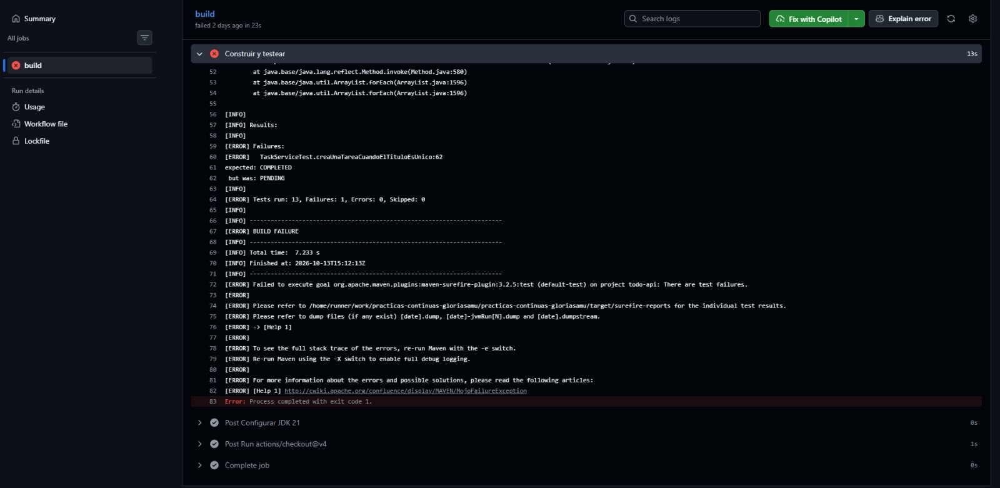

Se arregla el test y se hace push a la misma rama (commit 3). El PR se actualiza solo (`synchronize`), el CI vuelve a ejecutarse y pasa a verde (`logs/B-ci-verde.txt`):

```text
[INFO] Tests run: 13, Failures: 0, Errors: 0, Skipped: 0
[INFO] BUILD SUCCESS
```

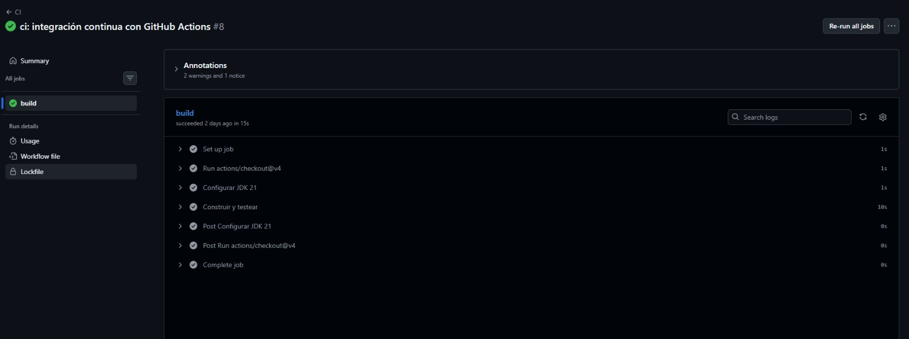

### Parte C — Separar responsabilidades en jobs

Con los tres jobs (commit 4), la ejecución muestra el grafo `lint → test → package`. Cada job empieza cuando termina el anterior:

```text
✓ lint in 13s
✓ test in 17s
✓ package in 17s
ARTIFACTS
app-jar
```

**Problema encontrado: el informe no aparecía.** La primera ejecución fue verde y el paso "Publicar informe de tests" también, pero entre los checks del commit no había ningún "Resultados JUnit", solo `lint`, `test` y `package` (`logs/C-checks.txt`). El log del paso terminaba en `Summary content:` y no decía nada de crear un check run. Revisando el código de la action (`src/main.ts`), el tag `v1` actual incluye la opción `use-actions-summary`, que por defecto vale `true`. Con ella, el informe se escribe en el **resumen del job** (la página de la ejecución) y **no se crea ningún check run**. Con `use-actions-summary: "false"` (commit 5), la action crea el check (`logs/C-ci-tres-jobs.txt`):

```text
Creating check run Resultados JUnit
Check run create response: 200
Check run HTML: https://github.com/samuelavilesc/practicas-continuas-gloriasamu/runs/115378853746

$ gh api repos/.../commits/24cd3b6/check-runs?check_name=Resultados%20JUnit
Resultados JUnit  success  13 passed, 0 failed and 0 skipped
```

Ahí es donde hace falta `checks: write`: crear un check run es escribir en la API de *Checks*. Sin ese permiso, con el `permissions: contents: read` global, la llamada devolvería `403 Resource not accessible by integration`.

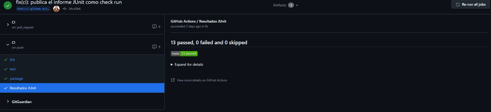

**El JAR.** El job `package` sube `target/*.jar` como artefacto `app-jar`, que se puede descargar desde la página de la ejecución durante 7 días (`logs/C-artefacto.txt`):

```text
[INFO] Building jar: /home/runner/work/.../target/todo-api-0.0.1-SNAPSHOT.jar
app-jar 44898252 bytes, expira 2026-10-20T15:14:43Z
```

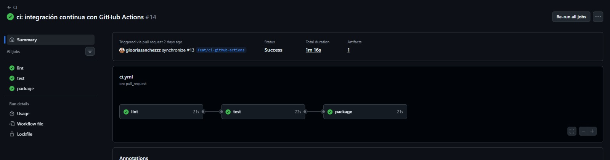

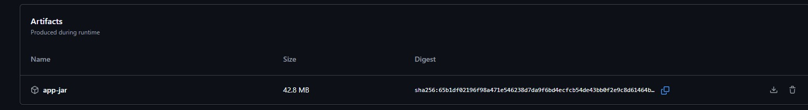

**Fallo de formato.** Se desordena `TaskNotFoundException` y se hace el commit con `--no-verify` (commit 6). El job `lint` falla y los otros dos no llegan a ejecutarse (`logs/C-lint-rojo.txt`):

```text
$ gh api repos/.../actions/runs/38421430270/jobs
lint: failure
test: skipped
package: skipped

[ERROR] Failed to execute goal com.diffplug.spotless:spotless-maven-plugin:2.43.0:check (default-cli) on project todo-api: The following files had format violations:
[ERROR]     src/main/java/es/practicascontinuas/todo/task/TaskNotFoundException.java
[ERROR]         -public·class·TaskNotFoundException·extends·RuntimeException{
[ERROR]         -······public·TaskNotFoundException(Long·id){·super("No·existe·una·tarea·con·id·"+id);·}
[ERROR]         +
[ERROR]         +public·class·TaskNotFoundException·extends·RuntimeException·{
[ERROR]         +··public·TaskNotFoundException(Long·id)·{
[ERROR]         +····super("No·existe·una·tarea·con·id·"·+·id);
[ERROR]         +··}
[ERROR] Run 'mvn spotless:apply' to fix these violations.
```

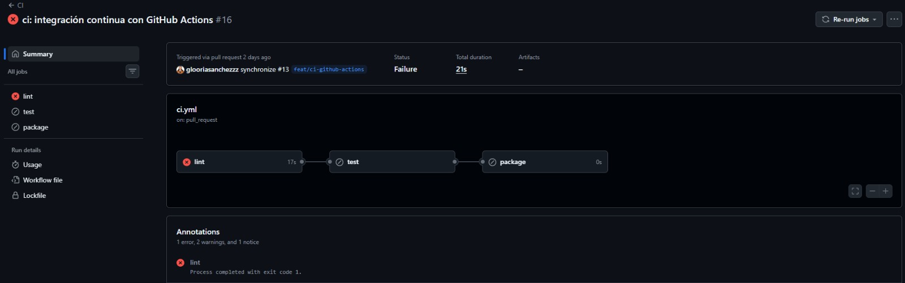

Con el formato restaurado (commit 7), los tres jobs vuelven a verde: `lint` en 17 s, `test` en 22 s y `package` en 23 s.

`--no-verify` demuestra para qué sirve el CI aunque exista el hook: el hook vive en la máquina de cada uno, se puede saltar y hay que activarlo a mano (`core.hooksPath`). El CI, en cambio, se ejecuta siempre y para todos.

**¿Por qué `lint` va primero?** Es el job más barato y rápido (no compila ni ejecuta tests) y el que falla por el motivo más trivial. Si va primero:
- el feedback llega antes: en unos 15 s se sabe que es un problema de formato, sin esperar a los tests;
- no se malgastan minutos de runner en tests y empaquetado de un código que de todos modos no se podrá fusionar;
- el fallo queda **localizado**: si el rojo está en `lint`, es formato; si está en `test`, es comportamiento. Con un solo job había que leer el log para distinguirlo.

**¿Por qué el informe lleva `if: always()`?** Por defecto, un paso solo se ejecuta si todos los anteriores han ido bien (`success()`). Cuando falla algún test, `mvn -B verify` termina con error y, sin `if: always()`, el paso del informe se saltaría. Sería justo el caso en que más falta hace saber qué test ha fallado y por qué. Con `always()`, el informe se publica también cuando los tests fallan, y el check "Resultados JUnit" muestra el test fallido con su mensaje.

**Avisos de GitHub.** Todas las ejecuciones muestran avisos de que `actions/checkout@v4`, `actions/setup-java@v4`, `actions/upload-artifact@v4` y `dorny/test-reporter@v1` son actions de Node.js 20 y el runner las fuerza a ejecutarse con Node.js 24, y de que `setup-java@v4` está obsoleta. No afectan al resultado. Se han mantenido las versiones que indica el boletín.

### Parte D — Convertir el CI en una barrera

Una vez fusionado el PR #13 (el CI ya está en `main`), Samuel, como administrador, edita la regla de protección de `main` del Boletín 2 y activa:

- **Require status checks to pass before merging**, con los checks `lint`, `test` y `package`. GitHub solo deja elegir checks que se hayan ejecutado en la última semana, por eso hay que hacerlo después de que el CI haya corrido al menos una vez.
- **Require branches to be up to date before merging**: la rama del PR tiene que incluir el último `main`, para que los checks se hayan ejecutado sobre el código que de verdad quedará al fusionar.

Se mantienen las reglas del Boletín 2 (una aprobación, conversaciones resueltas). Desde la API, con permisos de escritura, se ve la nueva condición:

```text
$ gh api repos/.../branches/main --jq .protection
{"enabled":true,"required_status_checks":{"contexts":["lint","test","package"],"enforcement_level":"everyone"}}
```

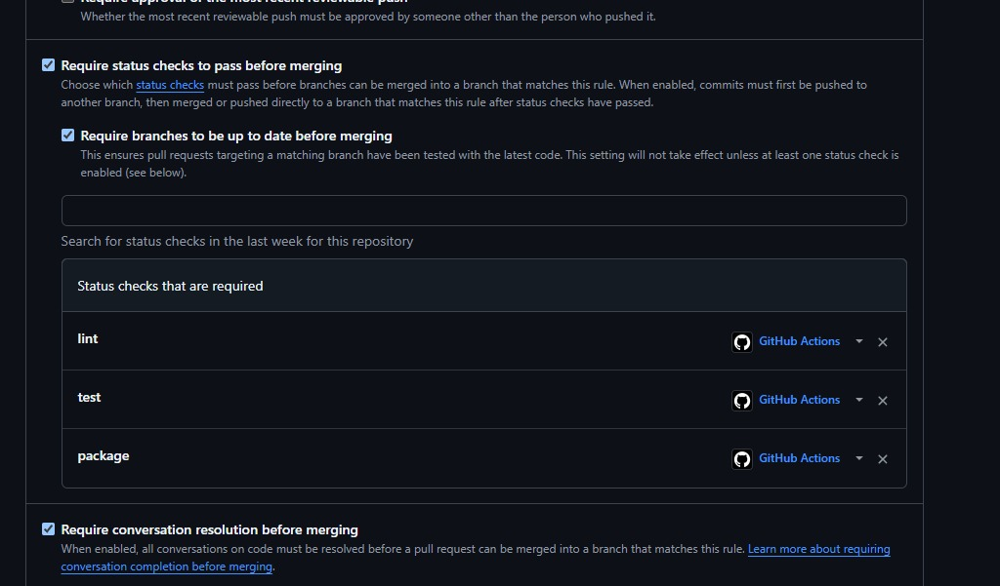

**Verificación.** Se abre el [PR #14](https://github.com/samuelavilesc/practicas-continuas-gloriasamu/pull/14) desde la rama `test/barrera-ci` con el mismo test roto de la Parte B (`logs/D-pr-test-roto.txt`):

```text
lint: success
test: failure
package: skipped
Resultados JUnit  failure  12 passed, 1 failed and 0 skipped
```

Al principio GitHub mostraba como motivo del bloqueo la revisión pendiente. Para comprobar que lo que bloquea son los checks, Samuel aprobó el PR #14: aun con la aprobación, el estado sigue siendo `BLOCKED` y el botón *Squash and merge* sale desactivado (`logs/D-estado-pr.txt`):

```text
$ gh pr view 14 --json mergeStateStatus,reviewDecision
BLOCKED APPROVED samuelavilesc 2026-10-15T12:13:47Z
```

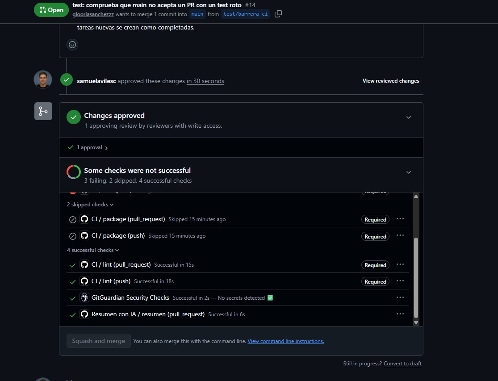

El PR #14 también sirve de prueba del `if: always()` de la Parte C: el job `test` falla y, aun así, el paso del informe se ejecuta y publica "Resultados JUnit" con el test fallido y su mensaje (`logs/D-informe-junit.txt`):

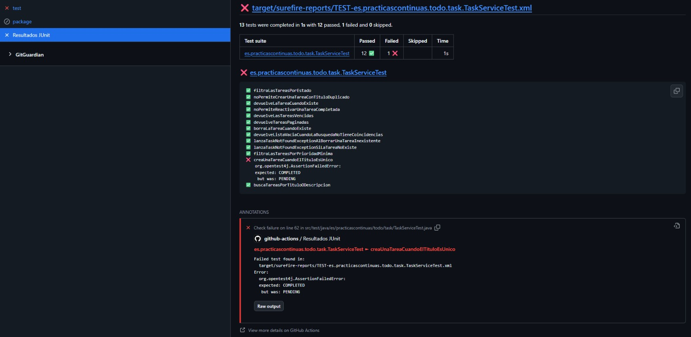

Comprobado el bloqueo, el PR #14 se cerró sin fusionar y se borró su rama.

### Parte E — Ampliaciones

**Ignorar los cambios del README** (commit 8). Con `paths-ignore: [ "README.md" ]`, un push que solo cambia el README no lanza el CI. En un PR, el filtro se aplica a **todos los ficheros cambiados del PR** respecto a `main`, no solo a los del último commit.

**Problema encontrado al juntarlo con la Parte D.** El badge se subió en el PR #15, que solo cambia el README. Como se esperaba, el push no lanzó el CI. Pero el `pull_request` tampoco, y como `lint`, `test` y `package` son ahora checks obligatorios, el PR se quedó esperando unos checks que nunca iban a llegar (`logs/E-pr-badge.txt`):

```text
BLOCKED
resumen SUCCESS
GitGuardian Security Checks SUCCESS
```

Es decir, con la protección de la Parte D, **un PR que solo toca el README no se podría fusionar nunca**. Se corrigió en el commit 11: el filtro se quita del evento `pull_request` y se deja solo en `push`. Así, un push que solo cambia el README sigue sin gastar CI, pero cualquier PR pasa los checks y se puede fusionar. Tras el commit, el CI del PR #15 se ejecutó y los tres jobs y el informe salieron en verde. La otra solución que documenta GitHub es un segundo workflow con los mismos nombres de job que pase siempre en esos casos, pero añade complejidad para muy poco ahorro.

**Resumen con IA y gestión de secretos** (commit 9). Puntos clave del workflow `ai-summary.yml`:

- El token **nunca está en el código**: se lee de `secrets.OLLAMA_API_KEY`, que GitHub inyecta como variable de entorno solo en ese paso y enmascara (`***`) si aparece en los logs. Lo crea Samuel, como administrador del repositorio, en *Settings → Secrets and variables → Actions → Repository secrets*. La primera vez lo creó dentro del *environment* `ci`, y el workflow no lo veía: los secretos de un environment solo llegan a los jobs que declaran `environment: ci`. Al crearlo como secreto del repositorio funcionó.
- Permisos mínimos: `contents: read` para hacer checkout y `pull-requests: write` para comentar.
- El diff se recorta a 60 000 caracteres para no superar el contexto del modelo.
- Cualquier error (falta el secreto, la API devuelve un error o la respuesta está vacía) deja como comentario exactamente **"La IA ha fallado"**. El paso que comenta lleva `if: always()`, así que el aviso llega aunque el paso anterior rompa de forma inesperada.
- Para no llenar el PR de comentarios en cada push, el bot edita su comentario anterior (`gh pr comment --edit-last --create-if-none`).

**Prueba sin secreto.** Antes de crear el secreto, el workflow publicó el comentario de error (`logs/E-ia-sin-secreto.txt`):

```text
##[warning]No está definido el secreto OLLAMA_API_KEY
$ gh api repos/.../issues/13/comments
github-actions[bot] 2026-10-13T16:15:09Z: La IA ha fallado
```

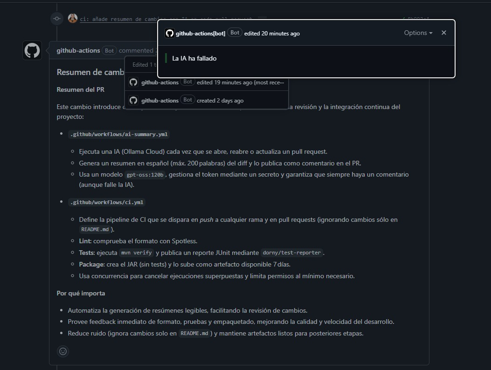

**Prueba con secreto.** Con el secreto creado se relanzó el workflow (`logs/E-ia-con-secreto.txt`). El bot sustituyó el comentario de error por el resumen (extracto):

```text
### Resumen de cambios generado por IA (gpt-oss:120b)
Este cambio introduce dos flujos de trabajo de GitHub Actions que automatizan la revisión y la integración continua del proyecto:
- .github/workflows/ai-summary.yml
  - Ejecuta una IA (Ollama Cloud) cada vez que se abre, reabre o actualiza un pull request. ...
- .github/workflows/ci.yml
  - Lint: comprueba el formato con Spotless.
  - Tests: ejecuta mvn verify y publica un reporte JUnit mediante dorny/test-reporter.
  - Package: crea el JAR (sin tests) y lo sube como artefacto disponible 7 días. ...
```

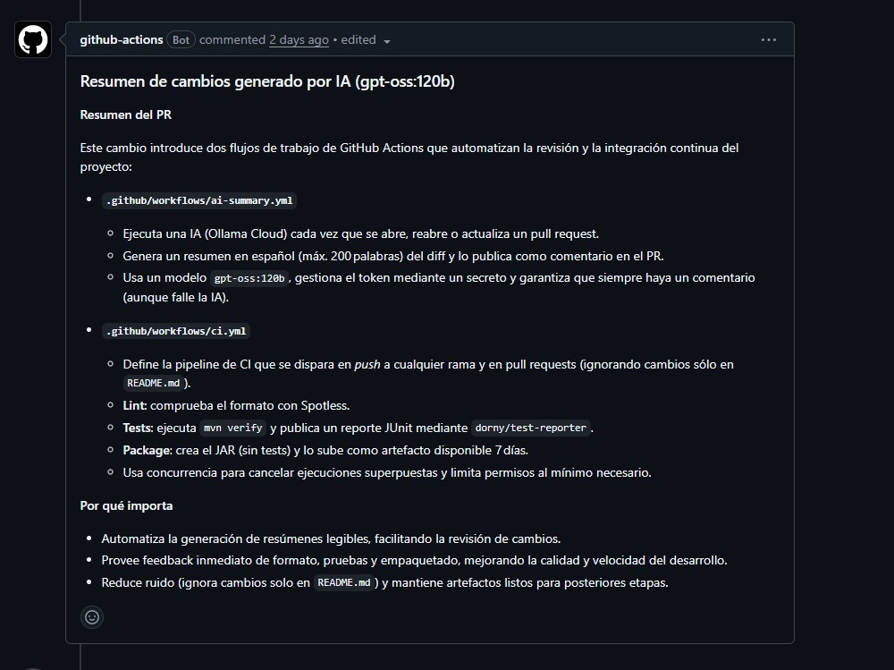

**Límites del resumen.** En el PR #14 de la Parte D, la IA describió bien el cambio de la aserción, pero se inventó el motivo: dijo que *"el código de `TaskService#create` ahora asigna el estado COMPLETED a una tarea recién creada"* y que el cambio *"evita falsos negativos"*, cuando el servicio no se había tocado y el test se rompió a propósito. Además, nombró el test como `create_shouldReturnTaskResponse`, que no existe. El resumen es útil para hacerse una idea rápida del PR, pero no sustituye a la revisión humana: solo ve el diff, no el resto del código.

**Badge** (commit 10). Bajo el título del README:

```markdown
[](https://github.com/samuelavilesc/practicas-continuas-gloriasamu/actions/workflows/ci.yml)
```

Con `?branch=main` el badge refleja el estado de `main` y no el de la última ejecución en cualquier rama. Se subió en el PR #15 (commit 10).

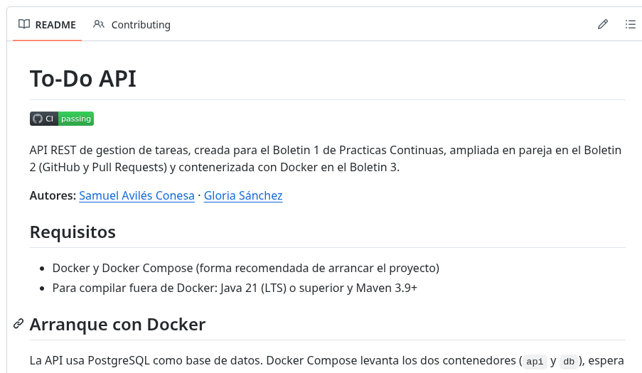

### Versionar los cambios

Se siguió el flujo de `CONTRIBUTING.md`:

1. [Issue #12](https://github.com/samuelavilesc/practicas-continuas-gloriasamu/issues/12) "[feat] Integración continua con GitHub Actions" con la plantilla `enhancement` y los criterios de aceptación.
2. Rama `feat/ci-github-actions` desde `main`, con los commits 1 a 9 de la tabla.
3. [PR #13](https://github.com/samuelavilesc/practicas-continuas-gloriasamu/pull/13) con la plantilla y `Closes #12`. Samuel aparece como revisor automáticamente por `CODEOWNERS`.
4. **Revisión:** Samuel revisó el PR y lo **aprobó** sin pedir cambios (14 de octubre, 13:37).
5. **Fusión:** *squash and merge* el 15 de octubre a las 13:56, como commit [`312f2c1`](https://github.com/samuelavilesc/practicas-continuas-gloriasamu/commit/312f2c1ad953256f1e1ebbf1adcf598d83c0a33a). El Issue #12 se cerró automáticamente gracias a `Closes #12`, y la rama se borró.
6. Después, el [PR #15](https://github.com/samuelavilesc/practicas-continuas-gloriasamu/pull/15) con el badge y la corrección del `paths-ignore` (commits 10 y 11, `Refs #12`). Samuel lo aprobó el 15 de octubre a las 14:28 y se fusionó con *squash and merge* a las 14:29, como commit [`8946e80`](https://github.com/samuelavilesc/practicas-continuas-gloriasamu/commit/8946e80fc7da4818239c02b249ff7834a0e60d9b).


## Uso de IA

Hemos usado **Claude** para:
- leer el boletín y planificar el trabajo y la estructura de esta memoria;
- escribir los workflows `ci.yml` y `ai-summary.yml`, los commits que rompen y arreglan el CI y el badge;
- seguir las ejecuciones con `gh` y guardar su salida en `logs/`;
- encontrar por qué no aparecía el check "Resultados JUnit" (`use-actions-summary`).

Todo se ha revisado antes de incorporarlo.
