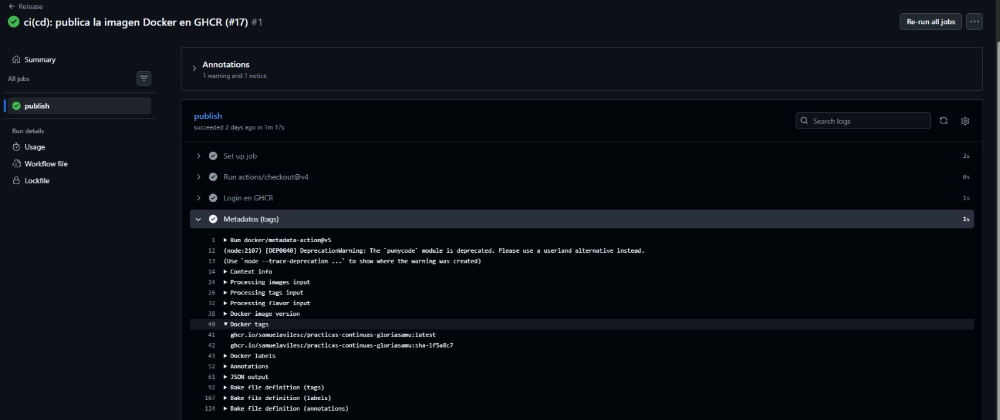
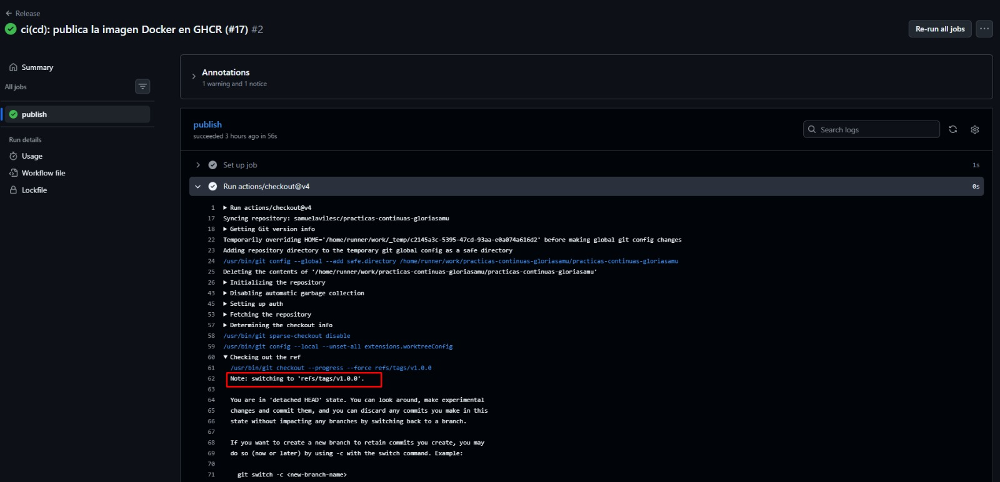
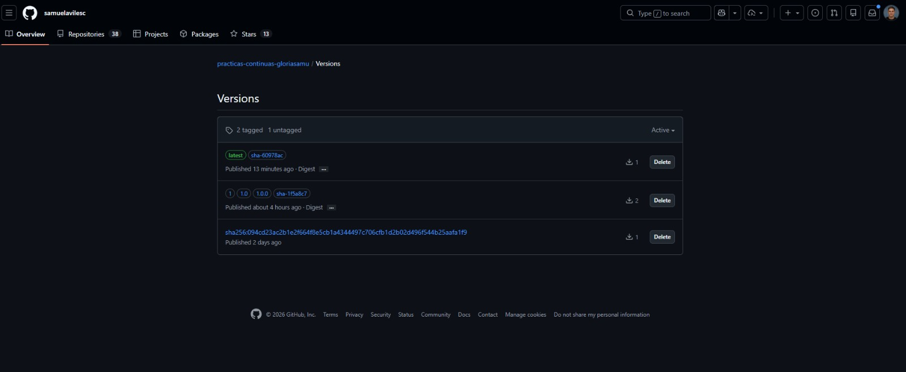
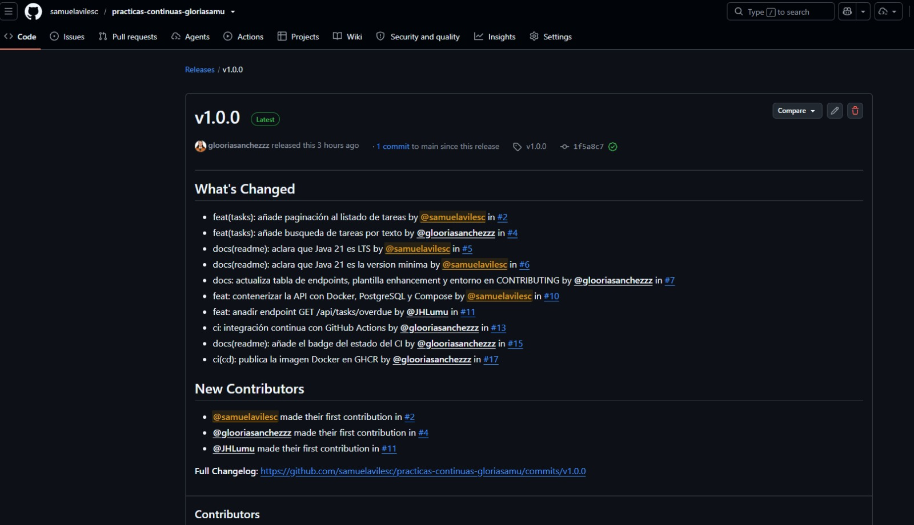
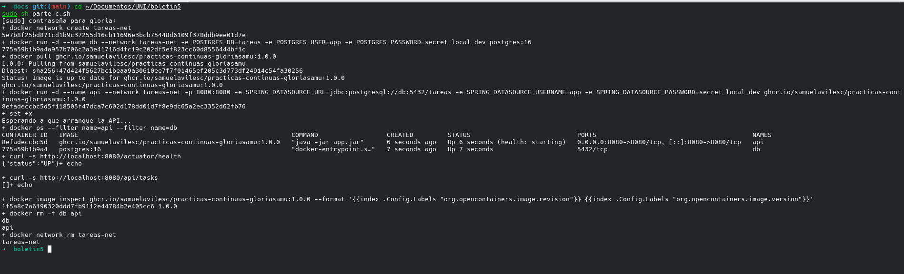
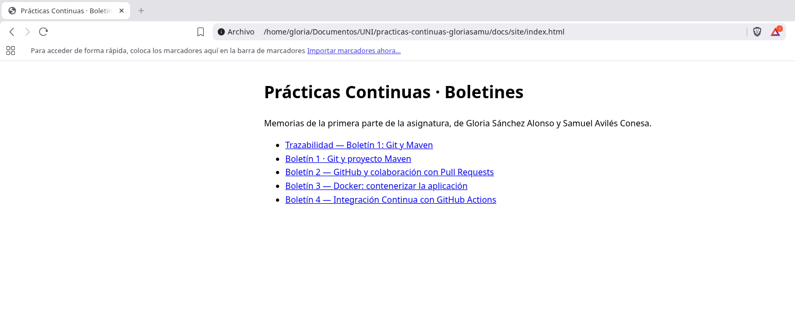
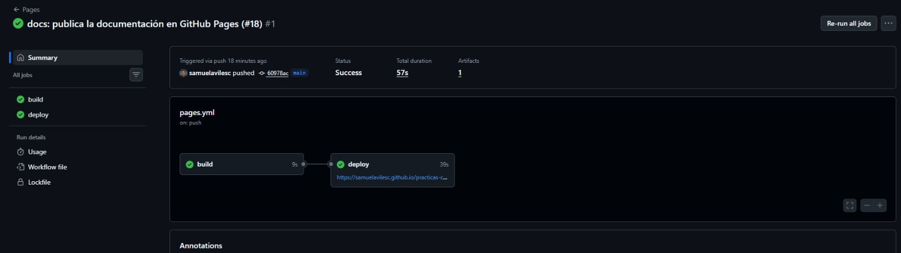
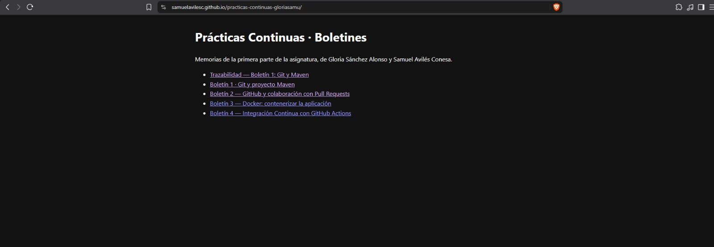
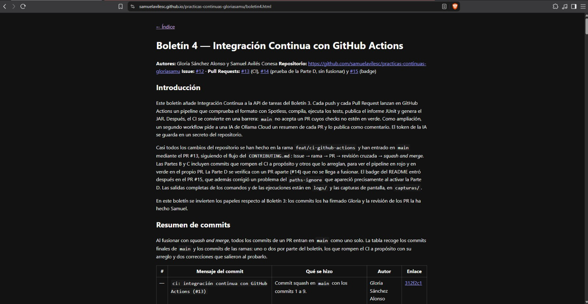

# Boletín 5 — Entrega Continua: construir, versionar y publicar la imagen

**Autores:** Gloria Sánchez Alonso y Samuel Avilés Conesa
**Repositorio:** https://github.com/samuelavilesc/practicas-continuas-gloriasamu
**Issue:** [#16](https://github.com/samuelavilesc/practicas-continuas-gloriasamu/issues/16) · **Pull Requests:** [#17](https://github.com/samuelavilesc/practicas-continuas-gloriasamu/pull/17) (publicación de la imagen) y [#18](https://github.com/samuelavilesc/practicas-continuas-gloriasamu/pull/18) (GitHub Pages)
**Release:** [v1.0.0](https://github.com/samuelavilesc/practicas-continuas-gloriasamu/releases/tag/v1.0.0) · **Imagen:** `ghcr.io/samuelavilesc/practicas-continuas-gloriasamu` · **Web:** https://samuelavilesc.github.io/practicas-continuas-gloriasamu/

## Introducción

Este boletín añade Entrega Continua al proyecto. Un nuevo workflow, `Release`, construye la imagen Docker de la API y la publica en GitHub Container Registry (`ghcr.io`) cada vez que se fusiona algo en `main` y cada vez que se publica una etiqueta de versión. Cada imagen lleva tags trazables: el SHA del commit que la produjo, la versión SemVer y `latest`. Después se publica la primera versión, `v1.0.0`, con su Release en GitHub, y se comprueba que la imagen descargada del registro arranca contra una PostgreSQL real. Por último, las memorias de los boletines pasan a la carpeta `docs/` del repositorio y un segundo workflow, `Pages`, las convierte en una web que se publica en GitHub Pages.

Los cambios del repositorio han entrado en `main` mediante dos PR, siguiendo el flujo del `CONTRIBUTING.md`: Issue → rama → PR → revisión cruzada → *squash and merge*. El PR #17 trae el workflow de publicación (Partes A y C) y el PR #18, la documentación y GitHub Pages (Parte D). La Parte B no modifica el repositorio: es la etiqueta `v1.0.0` y su Release. Las salidas completas de los comandos y de las ejecuciones están en `logs/boletin5/` y las capturas de pantalla, en `capturas/`.

Como en el Boletín 4, los commits los ha firmado Gloria y la revisión de los PR la ha hecho Samuel.

## Resumen de commits

Al fusionar con *squash and merge*, todos los commits de un PR entran en `main` como uno solo. La tabla recoge los dos commits finales de `main` y los commits de las ramas.

| # | Mensaje del commit | Qué se hizo | Autor | Enlace |
|---|--------------------|-------------|-------|--------|
| — | `ci(cd): publica la imagen Docker en GHCR (#17)` | Commit squash en `main` con los commits 1 a 4. | Gloria Sánchez Alonso | [1f5a8c7](https://github.com/samuelavilesc/practicas-continuas-gloriasamu/commit/1f5a8c7a6190320ddd7fb9112e44784b2e405cc6) |
| — | `docs: publica la documentación en GitHub Pages (#18)` | Commit squash en `main` con los commits 5 a 13. | Gloria Sánchez Alonso | [60978ac](https://github.com/samuelavilesc/practicas-continuas-gloriasamu/commit/60978ac38b72f4661161e70559c3fb2cb53474ed) |
| 1 | `ci(cd): publica la imagen Docker en GHCR` | Workflow `release.yml` del boletín. | Gloria Sánchez Alonso | [6e60ae3](https://github.com/samuelavilesc/practicas-continuas-gloriasamu/commit/6e60ae31abef8d313d1636848507cda6c7e81914) |
| 2 | `ci(release): permite lanzar el workflow a mano` | `workflow_dispatch` en `release.yml`. | Gloria Sánchez Alonso | [f1b497d](https://github.com/samuelavilesc/practicas-continuas-gloriasamu/commit/f1b497d4f739d91cc48d3da343c72d22d20eb8ba) |
| 3 | `docs(readme): documenta cómo ejecutar la imagen publicada` | Sección del README con los tags y los comandos de la Parte C. | Gloria Sánchez Alonso | [00328ea](https://github.com/samuelavilesc/practicas-continuas-gloriasamu/commit/00328ea3524ddc70dbe0dd1bedb3d28929c2ad94) |
| 4 | `docs(readme): añade el badge del workflow Release` | Badge de `Release` junto al de `CI`. | Gloria Sánchez Alonso | [5e3ec8d](https://github.com/samuelavilesc/practicas-continuas-gloriasamu/commit/5e3ec8dc2e5619cfb0b020caf33c7dc46134fe4c) |
| 5 | `docs: añade la memoria del boletín 1` | `docs/boletin1.md` (memoria de Samuel) y sus capturas. | Gloria Sánchez Alonso | [b58d928](https://github.com/samuelavilesc/practicas-continuas-gloriasamu/commit/b58d9281b9a88ad28c656cbd1351f0726853156a) |
| 6 | `docs: añade la memoria del boletín 2` | `docs/boletin2.md` y sus capturas. | Gloria Sánchez Alonso | [37d8c21](https://github.com/samuelavilesc/practicas-continuas-gloriasamu/commit/37d8c21d4cc90b3965e15cea76699404da96e245) |
| 7 | `docs: añade la memoria individual del boletín 1 de Gloria` | `docs/boletin1-gloria.md`. | Gloria Sánchez Alonso | [c9bb797](https://github.com/samuelavilesc/practicas-continuas-gloriasamu/commit/c9bb797c0d88486cb2012a213dca1b518295fb8b) |
| 8 | `docs: añade la memoria del boletín 3` | `docs/boletin3.md` y sus capturas. | Gloria Sánchez Alonso | [e87c5cf](https://github.com/samuelavilesc/practicas-continuas-gloriasamu/commit/e87c5cf0cea77556b71537dcd9b3c8fdce3ef91d) |
| 9 | `docs: corrección del boletín 2` | Se usa la versión entregada de la memoria del Boletín 2. | Gloria Sánchez Alonso | [0c61ba8](https://github.com/samuelavilesc/practicas-continuas-gloriasamu/commit/0c61ba8143fcd59e5e8fa2bfbe70cbe4ba48c4a8) |
| 10 | `docs: añade la memoria del boletín 4` | `docs/boletin4.md` y sus capturas. | Gloria Sánchez Alonso | [5eae413](https://github.com/samuelavilesc/practicas-continuas-gloriasamu/commit/5eae4133d1bbb75a0bea5bc79b76a3c0c1064baa) |
| 11 | `feat(docs): añade el generador de la web de documentación` | `docs/build-site.js`, `package.json`, `package-lock.json` y `.gitignore`. | Gloria Sánchez Alonso | [cbae095](https://github.com/samuelavilesc/practicas-continuas-gloriasamu/commit/cbae0958a353489c669df67aae28f0d2dede1f24) |
| 12 | `ci: publica la documentación en GitHub Pages` | Workflow `pages.yml`. | Gloria Sánchez Alonso | [2ba3cd0](https://github.com/samuelavilesc/practicas-continuas-gloriasamu/commit/2ba3cd0acaa05d40f1517296bdb4a15454b6ace0) |
| 13 | `fix(ci): evita que el resumen con IA falle con diffs grandes` | Corrige el recorte del diff en `ai-summary.yml`. | Gloria Sánchez Alonso | [e22e017](https://github.com/samuelavilesc/practicas-continuas-gloriasamu/commit/e22e017ba1032c27323f4eeb60a1af789150e069) |

## Detalle por commit

### 1. `ci(cd): publica la imagen Docker en GHCR`
- **Qué se hizo:** `.github/workflows/release.yml` con el contenido del boletín: se dispara con `push` a `main` y con etiquetas `v*.*.*`; permisos `contents: read` y `packages: write`; un job `publish` que hace login en `ghcr.io` con el `GITHUB_TOKEN`, calcula los tags con `docker/metadata-action` y construye y sube la imagen con `docker/build-push-action` usando el `Dockerfile` del Boletín 3.
- **Autor:** Gloria Sánchez Alonso.
- **Relación con el boletín:** Parte A.

### 2. `ci(release): permite lanzar el workflow a mano`
- **Qué se hizo:** se añade `workflow_dispatch`, para poder relanzar la publicación desde la pestaña Actions sin tener que hacer un push.
- **Autor:** Gloria Sánchez Alonso.
- **Relación con el boletín:** Parte A.

### 3. `docs(readme): documenta cómo ejecutar la imagen publicada`
- **Qué se hizo:** nueva sección "Imagen publicada en GitHub Container Registry" en el README, antes de "Arranque con Dev Container": la tabla de tags (`sha-<commit>`, `1.0.0`/`1.0`/`1` y `latest`) y los comandos para arrancar la imagen con una PostgreSQL en la misma red y limpiar después.
- **Autor:** Gloria Sánchez Alonso.
- **Relación con el boletín:** Parte C.

### 4. `docs(readme): añade el badge del workflow Release`
- **Qué se hizo:** badge `actions/workflows/release.yml/badge.svg?branch=main` debajo del de `CI`.
- **Autor:** Gloria Sánchez Alonso.
- **Relación con el boletín:** Parte A.

### 5 a 10. Memorias de los boletines
- **Qué se hizo:** cada memoria se copia a `docs/` y sus capturas a `docs/capturas/boletinN/`, cambiando las rutas de las imágenes para que apunten ahí. El Boletín 1 fue individual, así que están las dos memorias: la de Samuel (`boletin1.md`) y la de Gloria (`boletin1-gloria.md`). En el Boletín 2 se subió primero una versión de la memoria con dos frases añadidas después de la entrega, y en el commit 9 se sustituyó por la versión entregada.
- **Autor:** Gloria Sánchez Alonso.
- **Relación con el boletín:** Parte D.

### 11. `feat(docs): añade el generador de la web de documentación`
- **Qué se hizo:** `docs/build-site.js`, un script de Node que lee todos los `.md` de `docs/`, los convierte a HTML con la librería `marked` y los guarda en `docs/site/`, junto con un `index.html` que enlaza a todos y una copia de las capturas. Los enlaces entre documentos `.md` se reescriben a `.html`. `docs/package.json` y `docs/package-lock.json` fijan la versión de `marked` (12.0.2). En el `.gitignore` se añaden `docs/site/` y `docs/node_modules/`.
- **Autor:** Gloria Sánchez Alonso.
- **Relación con el boletín:** Parte D.

### 12. `ci: publica la documentación en GitHub Pages`
- **Qué se hizo:** `.github/workflows/pages.yml`, que en cada push a `main` (y a mano) instala las dependencias con `npm ci`, ejecuta el script y publica `docs/site/` con las acciones oficiales `configure-pages`, `upload-pages-artifact` y `deploy-pages`. Permisos `pages: write` e `id-token: write`, y `concurrency` sin cancelar despliegues en curso.
- **Autor:** Gloria Sánchez Alonso.
- **Relación con el boletín:** Parte D.

### 13. `fix(ci): evita que el resumen con IA falle con diffs grandes`
- **Qué se hizo:** en `ai-summary.yml` (Boletín 4) el diff se guarda en un fichero y se recorta después, en lugar de recortarlo con una tubería (ver Parte D).
- **Autor:** Gloria Sánchez Alonso.
- **Relación con el boletín:** Parte D, problema encontrado en el PR #18.

## Descripción narrativa de lo hecho en la sesión

### Parte A — Pipeline de publicación

Tras crear el [Issue #16](https://github.com/samuelavilesc/practicas-continuas-gloriasamu/issues/16) con la plantilla `enhancement`, se crea la rama `feat/cd-publicar-imagen` con los commits 1 a 4 y se abre el [PR #17](https://github.com/samuelavilesc/practicas-continuas-gloriasamu/pull/17) con `Refs #16`. Se usa `Refs` y no `Closes` porque el Issue también incluye GitHub Pages, que va en el PR #18.

El commit 2 añade `workflow_dispatch` para probar la publicación desde la rama antes de fusionar, pero no se pudo:

```text
$ gh workflow run release.yml --ref feat/cd-publicar-imagen
HTTP 404: workflow release.yml not found on the default branch
```

GitHub solo permite lanzar a mano un workflow que ya existe en la rama por defecto. Mientras `release.yml` solo está en la rama del PR, no se puede lanzar. Una vez fusionado, `workflow_dispatch` sí sirve para relanzar la publicación desde Actions.

Samuel aprobó el PR #17 y se fusionó el 19 de octubre a las 14:13. La fusión es un push a `main`, así que se dispararon `CI` y `Release` a la vez ([`logs/boletin5/A-release-main.txt`](logs/boletin5/A-release-main.txt)):

```text
DOCKER_METADATA_OUTPUT_JSON: {"tags":["ghcr.io/samuelavilesc/practicas-continuas-gloriasamu:latest",
                                      "ghcr.io/samuelavilesc/practicas-continuas-gloriasamu:sha-1f5a8c7"], ...}
#19 naming to ghcr.io/samuelavilesc/practicas-continuas-gloriasamu:latest done
#19 naming to ghcr.io/samuelavilesc/practicas-continuas-gloriasamu:sha-1f5a8c7 done
```



La imagen aparece en **Packages** con los tags `sha-1f5a8c7` y `latest`. El package es público: se puede consultar sin autenticarse.

```text
$ curl -H "Authorization: Bearer <token anónimo>" https://ghcr.io/v2/samuelavilesc/practicas-continuas-gloriasamu/tags/list
{"name":"samuelavilesc/practicas-continuas-gloriasamu","tags":["latest","sha-1f5a8c7"]}
```

**¿Qué ocurre en cada caso?**

`docker/metadata-action` calcula los tags a partir del evento que disparó el workflow. Cada línea de `tags:` es una regla que puede generar un tag o ninguno:

| Regla | Al fusionar un PR a `main` (`refs/heads/main`) | Al publicar `v1.0.0` (`refs/tags/v1.0.0`) |
|---|---|---|
| `type=sha,prefix=sha-` | `sha-1f5a8c7` | `sha-1f5a8c7` |
| `type=semver,pattern={{version}}` | nada: no hay etiqueta | `1.0.0` |
| `type=semver,pattern={{major}}.{{minor}}` | nada | `1.0` |
| `type=semver,pattern={{major}}` | nada | `1` |
| `type=raw,value=latest,enable={{is_default_branch}}` | `latest`: el push es a la rama por defecto | nada: un tag no es la rama por defecto |
| `flavor: latest=auto` (por defecto) | — | `latest`: es la versión SemVer más alta publicada |

1. **Al fusionar un PR a `main`**, el evento es un push a la rama `main`. Solo hay commit, no versión, así que se generan `sha-<commit>` (la trazabilidad exacta de esa imagen) y `latest` (el último build de `main`). Las reglas `semver` no generan nada porque no hay ninguna etiqueta que interpretar.
2. **Al publicar una etiqueta `vX.Y.Z`**, el evento es un push de un tag. `metadata-action` quita la `v` y genera los tres niveles de SemVer (`X.Y.Z`, `X.Y` y `X`), para que se pueda fijar una versión exacta o seguir automáticamente la última de una serie. También genera `sha-<commit>`, que es el mismo SHA que el del merge porque la etiqueta apunta a ese commit.

Lo que no esperábamos es que la etiqueta también genere `latest`. La regla `raw` no lo genera porque `is_default_branch` es falso para un tag, pero la action tiene por defecto `flavor: latest=auto`, que añade `latest` cuando se publica una versión SemVer. Se comprobó en la ejecución de la Parte B: `"tag-names":["1.0.0","1.0","1","sha-1f5a8c7","latest"]`.

### Parte B — Publicar una versión de verdad

Con `release.yml` ya en `main`, se crea la etiqueta anotada sobre el commit de la fusión y se sube:

```text
$ git tag -a v1.0.0 -m "Primera versión publicable de la API de tareas"
$ git show v1.0.0 --no-patch
tag v1.0.0
Tagger: Gloria Sánchez Alonso <g.sanchezalonso@um.es>
Date:   Wed Oct 21 09:27:18 2026 +0200

Primera versión publicable de la API de tareas

commit 1f5a8c7a6190320ddd7fb9112e44784b2e405cc6
$ git push origin v1.0.0
 * [new tag]         v1.0.0 -> v1.0.0
```

Una etiqueta anotada, a diferencia de una ligera, es un objeto propio en Git: guarda quién la creó, cuándo y un mensaje.

El push de la etiqueta vuelve a disparar `Release` ([`logs/boletin5/B-release-tag.txt`](logs/boletin5/B-release-tag.txt)), que publica la misma imagen con los nuevos tags ([`logs/boletin5/B-tags-ghcr.txt`](logs/boletin5/B-tags-ghcr.txt)):

```text
"tag-names":["1.0.0","1.0","1","sha-1f5a8c7","latest"]

$ curl .../v2/samuelavilesc/practicas-continuas-gloriasamu/tags/list
{"name":"samuelavilesc/practicas-continuas-gloriasamu","tags":["latest","sha-1f5a8c7","1.0.0","1.0","1"]}
```





En Packages se ve un detalle de la trazabilidad. La versión con `1.0.0`, `1.0`, `1` y `sha-1f5a8c7` **no es la misma imagen** que publicó el merge del PR #17, aunque se construyó desde el mismo commit. Al publicar la etiqueta se volvió a construir, y la imagen nueva tiene otro digest, porque lleva otra fecha de creación y otras etiquetas OCI (`version: 1.0.0`). Los tags `sha-1f5a8c7` y `latest` pasaron a la imagen nueva, y la del 19 de octubre se quedó *untagged*, accesible solo por su digest (`sha256:094cd23a…`). Más tarde, la fusión del PR #18 movió `latest` a `sha-60978ac` (ver Parte D).

Después se crea la [Release v1.0.0](https://github.com/samuelavilesc/practicas-continuas-gloriasamu/releases/tag/v1.0.0) a partir de la etiqueta, con las notas generadas automáticamente por GitHub ([`logs/boletin5/B-release-notas.txt`](logs/boletin5/B-release-notas.txt)). Como es la primera Release, las notas recogen todos los PR fusionados desde el principio del proyecto, del #2 al #17, con su autor:

```text
## What's Changed
* feat(tasks): añade paginación al listado de tareas by @samuelavilesc in .../pull/2
* feat(tasks): añade busqueda de tareas por texto by @glooriasanchezzz in .../pull/4
...
* ci(cd): publica la imagen Docker en GHCR by @glooriasanchezzz in .../pull/17
```



### Parte C — Verificar la imagen publicada

Se descarga la imagen `1.0.0` del registro y se arranca junto a una PostgreSQL en la misma red, con los comandos del boletín, que también están en el README desde el commit 3. El usuario de este equipo no está en el grupo `docker`, así que los comandos se lanzaron con `sudo` ([`logs/boletin5/C-verificacion.txt`](logs/boletin5/C-verificacion.txt)):

```text
+ docker network create tareas-net
+ docker run -d --name db --network tareas-net -e POSTGRES_DB=tareas -e POSTGRES_USER=app -e POSTGRES_PASSWORD=secret_local_dev postgres:16
+ docker pull ghcr.io/samuelavilesc/practicas-continuas-gloriasamu:1.0.0
Digest: sha256:47d424f5627bc1beaa9a30610ee7f7f01465ef205c3d773df24914c54fa30256
Status: Image is up to date for ghcr.io/samuelavilesc/practicas-continuas-gloriasamu:1.0.0
+ docker run -d --name api --network tareas-net -p 8080:8080 -e SPRING_DATASOURCE_URL=jdbc:postgresql://db:5432/tareas ... ghcr.io/samuelavilesc/practicas-continuas-gloriasamu:1.0.0
+ docker ps --filter name=api --filter name=db
IMAGE                                                        STATUS                            NAMES
ghcr.io/samuelavilesc/practicas-continuas-gloriasamu:1.0.0   Up 6 seconds (health: starting)   api
postgres:16                                                  Up 7 seconds                      db
+ curl -s http://localhost:8080/actuator/health
{"status":"UP"}
+ curl -s http://localhost:8080/api/tasks
[]
+ docker image inspect ghcr.io/.../practicas-continuas-gloriasamu:1.0.0 --format '{{index .Config.Labels "org.opencontainers.image.revision"}} {{index .Config.Labels "org.opencontainers.image.version"}}'
1f5a8c7a6190320ddd7fb9112e44784b2e405cc6 1.0.0
+ docker rm -f db api
+ docker network rm tareas-net
```

La API responde `UP` y la lista de tareas vacía, así que la imagen descargada del registro funciona sin compilar nada en local. El log es de la segunda ejecución, que se hizo para la captura: en la primera el `pull` descargó la imagen (`Downloaded newer image`) y en esta ya estaba en local (`Image is up to date`), con el mismo digest `sha256:47d424f5…`. El `pull` no pidió autenticación porque el package es público.

Las etiquetas OCI que añade `metadata-action` a la imagen dan la trazabilidad completa sin depender del nombre del tag: `org.opencontainers.image.revision` es el commit exacto (`1f5a8c7…`) y `org.opencontainers.image.version`, la versión (`1.0.0`).



### Parte D — GitHub Pages de la documentación

En la rama `docs/github-pages` se añaden las memorias, el generador y el workflow (commits 5 a 12), y se abre el [PR #18](https://github.com/samuelavilesc/practicas-continuas-gloriasamu/pull/18) con `Closes #16`.

**Memorias.** Cada `boletinN.md` va a `docs/` y sus capturas, a `docs/capturas/boletinN/`. Así las imágenes de distintos boletines con el mismo nombre (`1.png`, `2.png`…) no se pisan. Las memorias citan ficheros de `logs/` que en este PR no se subieron al repositorio. Se añadieron después, junto con la memoria del Boletín 6, en `docs/logs/boletinN/`.

**Generador.** Antes del commit se probó en local:

```text
$ cd docs && npm ci && node build-site.js
  boletin1-gloria.md -> site/boletin1-gloria.html
  boletin1.md -> site/boletin1.html
  boletin2.md -> site/boletin2.html
  boletin3.md -> site/boletin3.html
  boletin4.md -> site/boletin4.html
Web generada en .../docs/site (5 documentos)
```



`npm ci` instala exactamente lo que dice `package-lock.json`, igual que hará el workflow, y `docs/site/` y `docs/node_modules/` quedan fuera del repositorio gracias al `.gitignore`. La web es un resultado del build, igual que `target/` en Maven: se genera a partir de los `.md`, que son la fuente.

**Configuración.** El repositorio ya era público y Samuel cambió *Settings → Pages → Source* a **GitHub Actions**. Con esa opción, GitHub no publica una rama, sino el artefacto que sube el workflow con `upload-pages-artifact`.

**Problema encontrado: el resumen con IA fallaba.** En el PR #18, el workflow `Resumen con IA` del Boletín 4 salió en rojo y comentó "La IA ha fallado":

```text
##[error]Process completed with exit code 141.
```

El diff de este PR, con las memorias de cuatro boletines, es mucho más grande que los anteriores. El workflow lo recortaba con `git diff … | head -c 60000`: cuando `head` tiene sus 60 000 caracteres, deja de leer y `git diff` recibe la señal SIGPIPE (código 141). Con `set -o pipefail`, ese código hace fallar el paso antes de llamar a la IA. El aviso "La IA ha fallado" funcionó como se diseñó, pero la causa era el recorte, no la IA. En el commit 13 el diff se guarda primero en un fichero y después se recorta con `head`, que ya no corta ninguna tubería. Tras el commit, el workflow salió en verde y el comentario pasó a mostrar el resumen del PR.

**Publicación.** Samuel aprobó el PR #18 y se fusionó el 21 de octubre a las 12:57. El push a `main` lanzó tres workflows: `CI`, `Release` y `Pages` ([`logs/boletin5/D-pages.txt`](logs/boletin5/D-pages.txt)):

```text
Run node build-site.js
Web generada en /home/runner/work/.../docs/site (5 documentos)
Artifact github-pages has been successfully uploaded! Final size is 5599576 bytes.
Created deployment for 60978ac38b72f4661161e70559c3fb2cb53474ed
```



La web quedó publicada en **https://samuelavilesc.github.io/practicas-continuas-gloriasamu/**, con el índice y las cinco memorias. Se comprobó que cargan tanto las páginas como las capturas:

```text
https://samuelavilesc.github.io/practicas-continuas-gloriasamu/   200
.../boletin4.html                                                 200
.../capturas/boletin4/1.png                                       200
```





La misma fusión también lanzó `Release`, que publicó la imagen `sha-60978ac` y movió `latest` a ese commit ([`logs/boletin5/A-release-merge-pr18.txt`](logs/boletin5/A-release-merge-pr18.txt): `"tag-names":["latest","sha-60978ac"]`). Es justo lo esperado en Entrega Continua: cada cambio que llega a `main` deja una imagen nueva lista para desplegar, aunque solo cambie la documentación, mientras que `1.0.0` sigue apuntando a la versión publicada.

### Versionar los cambios

1. [Issue #16](https://github.com/samuelavilesc/practicas-continuas-gloriasamu/issues/16) "[feat] Boletín 5: Entrega Continua (publicar imagen en GHCR + GitHub Pages)" con la plantilla `enhancement`.
2. [PR #17](https://github.com/samuelavilesc/practicas-continuas-gloriasamu/pull/17), rama `feat/cd-publicar-imagen`, commits 1 a 4 y `Refs #16`. Samuel lo aprobó el 19 de octubre a las 14:12 y se fusionó con *squash and merge* a las 14:13 como [`1f5a8c7`](https://github.com/samuelavilesc/practicas-continuas-gloriasamu/commit/1f5a8c7a6190320ddd7fb9112e44784b2e405cc6).
3. Etiqueta `v1.0.0` y [Release v1.0.0](https://github.com/samuelavilesc/practicas-continuas-gloriasamu/releases/tag/v1.0.0), el 21 de octubre a las 09:27.
4. [PR #18](https://github.com/samuelavilesc/practicas-continuas-gloriasamu/pull/18), rama `docs/github-pages`, commits 5 a 13 y `Closes #16`. Samuel lo aprobó el 21 de octubre a las 12:54 y se fusionó a las 12:57 como [`60978ac`](https://github.com/samuelavilesc/practicas-continuas-gloriasamu/commit/60978ac38b72f4661161e70559c3fb2cb53474ed). El Issue #16 se cerró automáticamente.
5. Esta memoria se añade a `docs/boletin5.md` en un PR posterior, para poder citar los commits ya fusionados. Al fusionarlo, `Pages` vuelve a publicar la web con los cinco boletines.

## Uso de IA

Hemos usado **Claude** para:
- leer el boletín y la guía de trabajo y planificar los PR y la estructura de esta memoria;
- revisar el workflow `release.yml` y el generador de la web antes de subirlos, y probar el generador en local;
- seguir las ejecuciones con `gh`, guardar su salida en `logs/boletin5/` y preparar el script de la Parte C;
- encontrar por qué fallaba el resumen con IA en el PR #18 (SIGPIPE con `pipefail`) y corregirlo;
- explicar por qué la etiqueta `v1.0.0` también genera `latest`.

Todo se ha revisado antes de incorporarlo.
