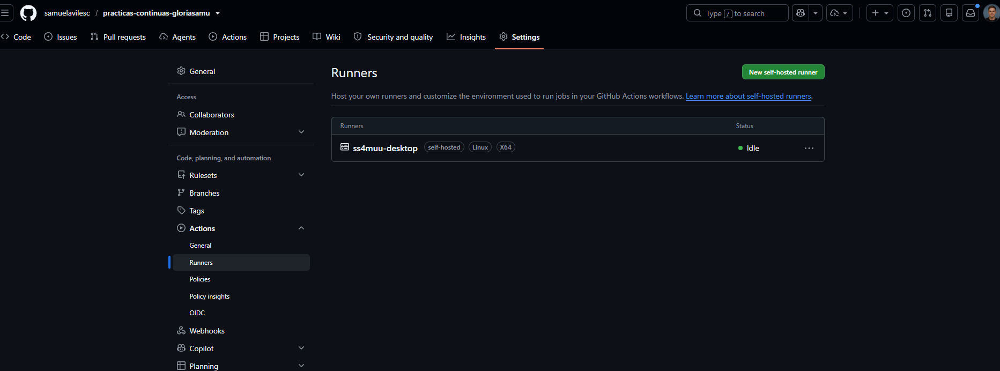
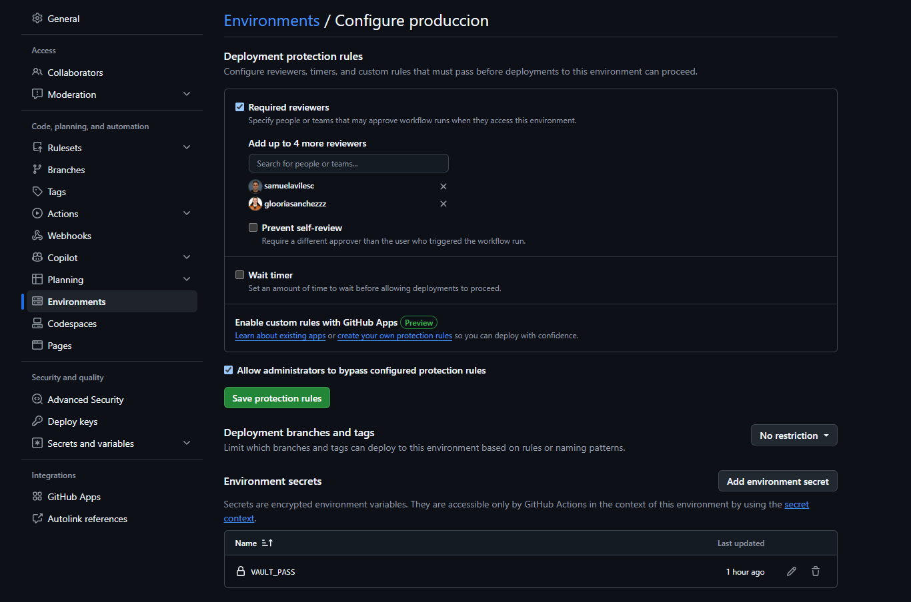
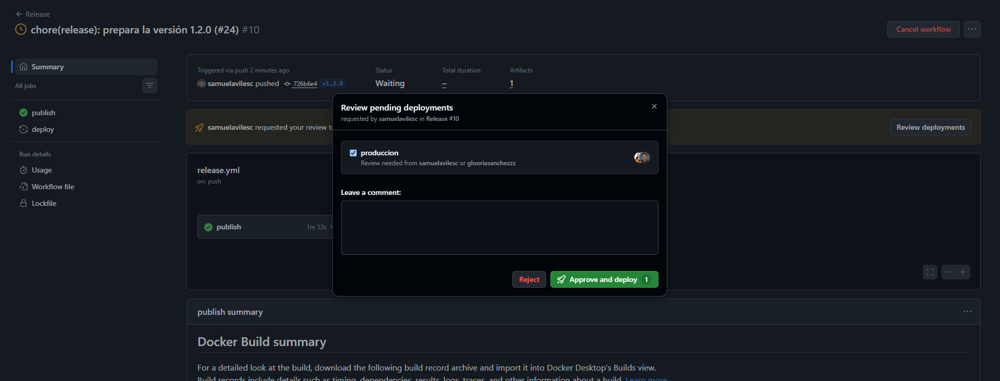
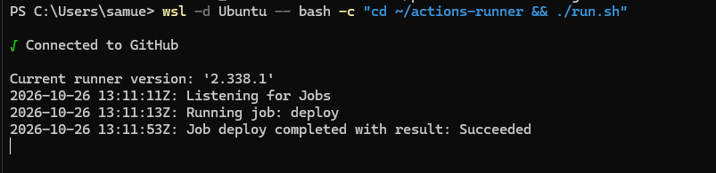
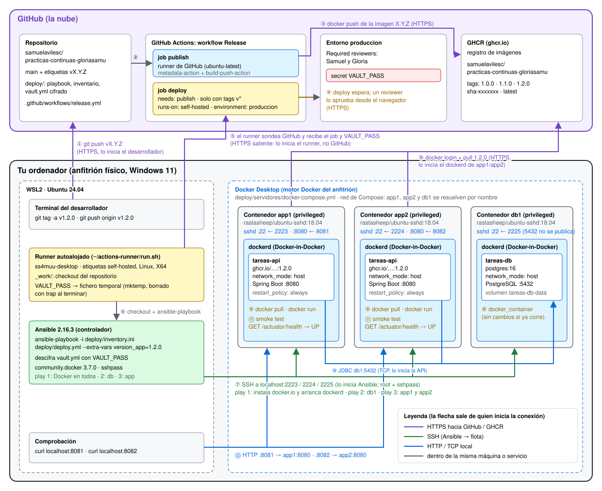

# Boletín 6 — Despliegue con Ansible

**Autores:** Gloria Sánchez Alonso y Samuel Avilés Conesa
**Repositorio:** https://github.com/samuelavilesc/practicas-continuas-gloriasamu
**Issue:** [#20](https://github.com/samuelavilesc/practicas-continuas-gloriasamu/issues/20) · **Pull Requests:** [#21](https://github.com/samuelavilesc/practicas-continuas-gloriasamu/pull/21) (despliegue con Ansible), [#22](https://github.com/samuelavilesc/practicas-continuas-gloriasamu/pull/22) (versión en `/actuator/info`), [#23](https://github.com/samuelavilesc/practicas-continuas-gloriasamu/pull/23) (job `deploy`) y [#24](https://github.com/samuelavilesc/practicas-continuas-gloriasamu/pull/24) (versión 1.2.0)
**Etiquetas:** [v1.1.0](https://github.com/samuelavilesc/practicas-continuas-gloriasamu/tree/v1.1.0) y [v1.2.0](https://github.com/samuelavilesc/practicas-continuas-gloriasamu/tree/v1.2.0) · **Imagen:** `ghcr.io/samuelavilesc/practicas-continuas-gloriasamu`

## Introducción

Hasta el Boletín 5, el workflow `Release` construía y publicaba la imagen de la API en GHCR, pero nadie la ejecutaba. En este boletín se despliega con Ansible sobre una pequeña flota de tres "servidores": dos para la API (`app1` y `app2`) y uno para PostgreSQL (`db1`). Los servidores son contenedores con SSH que corren en el Docker del portátil. El playbook instala Docker en toda la flota, arranca la base de datos y después la API en las dos réplicas, siempre con un tag inmutable (`1.0.0`, `1.1.0`…), nunca con `latest`. Las credenciales van cifradas con Ansible Vault.

Primero se despliega a mano: la versión `1.0.0`, una segunda ejecución para comprobar la idempotencia, la versión nueva `1.1.0` y un rollback a `1.0.0`. Después se cierra el ciclo de CD: al publicar una etiqueta `vX.Y.Z`, el job `deploy` de `release.yml` se queda esperando la aprobación de un revisor en el entorno `produccion` y, una vez aprobado, lanza el playbook en un runner autoalojado instalado en el portátil.

Los cambios han entrado en `main` mediante cuatro PR, siguiendo el flujo del `CONTRIBUTING.md`: Issue → rama → PR → revisión cruzada → *squash and merge*. Esta vez los commits los ha firmado Samuel y la revisión de los PR la ha hecho Gloria. Las salidas completas de los comandos y de las ejecuciones están en `logs/boletin6/`, y las capturas y el diagrama, en `capturas/boletin6/`.

El equipo en el que se ha hecho la práctica es Windows 11. Docker es Docker Desktop, y Ansible, `sshpass` y el runner se han instalado en WSL2 (Ubuntu 24.04), que es Linux y además tiene acceso al Docker de Docker Desktop.

## Resumen de commits

Al fusionar con *squash and merge*, todos los commits de un PR entran en `main` como uno solo. La tabla recoge los commits finales de `main` y los commits de las ramas.

| # | Mensaje del commit | Qué se hizo | Autor | Enlace |
|---|--------------------|-------------|-------|--------|
| — | `feat(deploy): despliegue multi-host con Ansible (#21)` | Commit squash en `main` con los commits 1 a 5. | Samuel Avilés Conesa | [b1b7deb](https://github.com/samuelavilesc/practicas-continuas-gloriasamu/commit/b1b7deb31588388c8c5902e4940dfce12139d14c) |
| — | `feat(info): expone la versión desplegada en /actuator/info (#22)` | Commit squash en `main` con el commit 6. Lleva la etiqueta `v1.1.0`. | Samuel Avilés Conesa | [7798029](https://github.com/samuelavilesc/practicas-continuas-gloriasamu/commit/7798029748b4e10b119d89697fde693e9241f6af) |
| — | `ci(cd): despliega con Ansible al publicar una versión (#23)` | Commit squash en `main` con el commit 7. | Samuel Avilés Conesa | [2405a0e](https://github.com/samuelavilesc/practicas-continuas-gloriasamu/commit/2405a0ebfb08e1c94abb334974dd66af1c0145a7) |
| — | `chore(release): prepara la versión 1.2.0 (#24)` | Commit squash en `main` con el commit 8. Lleva la etiqueta `v1.2.0`. | Samuel Avilés Conesa | [726b6e4](https://github.com/samuelavilesc/practicas-continuas-gloriasamu/commit/726b6e4d4a186786c064dcbcc4518b2704387008) |
| 1 | `chore(deploy): declara la collection community.docker 3.7.0` | `deploy/requirements.yml`. | Samuel Avilés Conesa | [7145227](https://github.com/samuelavilesc/practicas-continuas-gloriasamu/commit/7145227) |
| 2 | `feat(deploy): añade la flota de servidores y el inventario por roles` | `deploy/servidores/docker-compose.yml` y `deploy/inventory.ini`. | Samuel Avilés Conesa | [1b0a0e2](https://github.com/samuelavilesc/practicas-continuas-gloriasamu/commit/1b0a0e2) |
| 3 | `feat(deploy): añade el playbook de despliegue multi-host` | `deploy/deploy.yml`. | Samuel Avilés Conesa | [1239cb5](https://github.com/samuelavilesc/practicas-continuas-gloriasamu/commit/1239cb5) |
| 4 | `feat(deploy): cifra las credenciales con Ansible Vault` | `deploy/group_vars/servidores/vault.yml`. | Samuel Avilés Conesa | [5f9389e](https://github.com/samuelavilesc/practicas-continuas-gloriasamu/commit/5f9389e) |
| 5 | `docs(readme): documenta el despliegue con Ansible` | Sección "Despliegue con Ansible" en el README. | Samuel Avilés Conesa | [080a346](https://github.com/samuelavilesc/practicas-continuas-gloriasamu/commit/080a346) |
| 6 | `feat(info): expone la versión desplegada en /actuator/info` | Versión 1.1.0 en el `pom.xml` y goal `build-info`. | Samuel Avilés Conesa | [d2e6f76](https://github.com/samuelavilesc/practicas-continuas-gloriasamu/commit/d2e6f76) |
| 7 | `ci(cd): despliega con Ansible al publicar una versión` | `outputs.version` en `publish` y job `deploy` en `release.yml`. | Samuel Avilés Conesa | [93229bf](https://github.com/samuelavilesc/practicas-continuas-gloriasamu/commit/93229bf) |
| 8 | `chore(release): prepara la versión 1.2.0` | Versión 1.2.0 en el `pom.xml`. | Samuel Avilés Conesa | [2eb1486](https://github.com/samuelavilesc/practicas-continuas-gloriasamu/commit/2eb1486) |

## Detalle por commit

### 1. `chore(deploy): declara la collection community.docker 3.7.0`
- **Qué se hizo:** `deploy/requirements.yml` fija la collection `community.docker` en la versión 3.7.0, para que cualquiera (y el runner) instale exactamente la misma con `ansible-galaxy collection install -r deploy/requirements.yml`.
- **Autor:** Samuel Avilés Conesa.
- **Relación con el boletín:** Parte A.

### 2. `feat(deploy): añade la flota de servidores y el inventario por roles`
- **Qué se hizo:** `deploy/servidores/docker-compose.yml` con los tres contenedores `rastasheep/ubuntu-sshd:18.04` en modo `privileged` (`app1` en los puertos 2223 y 8081, `app2` en 2224 y 8082, y `db1` en 2225), y `deploy/inventory.ini` con los grupos `app` y `db`, el grupo padre `servidores` y las variables de conexión comunes.
- **Autor:** Samuel Avilés Conesa.
- **Relación con el boletín:** Partes B y C.

### 3. `feat(deploy): añade el playbook de despliegue multi-host`
- **Qué se hizo:** `deploy/deploy.yml` con tres *plays*: instalar y arrancar Docker en `servidores`, PostgreSQL 16 en `db` y la API en `app`, con login en GHCR, `pull` de la imagen, contenedor con `network_mode: host` y un smoke test contra `/actuator/health`. La imagen es la nuestra (`ghcr.io/samuelavilesc/practicas-continuas-gloriasamu`) y la versión llega en la variable `version_app`.
- **Autor:** Samuel Avilés Conesa.
- **Relación con el boletín:** Parte D.

### 4. `feat(deploy): cifra las credenciales con Ansible Vault`
- **Qué se hizo:** `deploy/group_vars/servidores/vault.yml`, cifrado con AES256, con `ghcr_user`, `ghcr_token`, `db_name`, `db_user` y `db_pass`. Al estar en `group_vars/servidores/`, Ansible lo carga solo para todos los hosts del grupo.
- **Autor:** Samuel Avilés Conesa.
- **Relación con el boletín:** Parte E.

### 5. `docs(readme): documenta el despliegue con Ansible`
- **Qué se hizo:** nueva sección "Despliegue con Ansible" en el README con los requisitos y los comandos para levantar la flota y desplegar una versión.
- **Autor:** Samuel Avilés Conesa.
- **Relación con el boletín:** Partes B a F.

### 6. `feat(info): expone la versión desplegada en /actuator/info`
- **Qué se hizo:** la versión del proyecto pasa de `0.0.1-SNAPSHOT` a `1.1.0` y `spring-boot-maven-plugin` ejecuta el goal `build-info`. Así, `/actuator/info` (ya expuesto desde el Boletín 3) devuelve `build.version`, y se puede ver qué versión corre en cada réplica.
- **Autor:** Samuel Avilés Conesa.
- **Relación con el boletín:** Parte F (cambio visible para la versión `v1.1.0`).

### 7. `ci(cd): despliega con Ansible al publicar una versión`
- **Qué se hizo:** en `release.yml`, el job `publish` expone `outputs.version` y se añade el job `deploy` del boletín (`needs: publish`, solo con etiquetas `v*`, `runs-on: self-hosted` y `environment: produccion`).
- **Autor:** Samuel Avilés Conesa.
- **Relación con el boletín:** Parte G.3.

### 8. `chore(release): prepara la versión 1.2.0`
- **Qué se hizo:** la versión del `pom.xml` pasa a `1.2.0`, la que se publica con la etiqueta `v1.2.0` para la prueba de extremo a extremo.
- **Autor:** Samuel Avilés Conesa.
- **Relación con el boletín:** Parte G.4.

## Descripción narrativa de lo hecho en la sesión

Tras crear el [Issue #20](https://github.com/samuelavilesc/practicas-continuas-gloriasamu/issues/20) con la plantilla `enhancement`, se crea la rama `feat/despliegue-ansible` para las Partes A a F.

### Parte A — Instalar Ansible y sus dependencias

Ansible se instala en WSL con `apt`, que en Ubuntu 24.04 da justo la versión que pide el boletín ([`logs/boletin6/A-B-C-instalacion-ping.txt`](logs/boletin6/A-B-C-instalacion-ping.txt)):

```text
$ ansible --version
ansible [core 2.16.3]
$ ansible-galaxy collection install -r deploy/requirements.yml
Nothing to do. All requested collections are already installed.
$ ansible-galaxy collection list community.docker
# /usr/lib/python3/dist-packages/ansible_collections
community.docker 3.7.0
```

Nos sorprendió el `Nothing to do`. El paquete `ansible` de Ubuntu no es solo `ansible-core`: incluye un lote de collections de la comunidad, y entre ellas viene `community.docker` precisamente en la versión 3.7.0. Por eso `ansible-galaxy` no tiene nada que instalar. Aun así, se deja `deploy/requirements.yml` en el repositorio: en otra máquina (por ejemplo, con Ansible instalado con `pipx`, que solo trae `ansible-core`) es lo que garantiza que se usa esa versión.

### Parte B — Preparar la flota de servidores destino

Se levanta la flota con el `docker-compose.yml` de `deploy/servidores/` y se comprueba que se entra por SSH en las tres máquinas antes de usar Ansible:

```text
$ docker compose -f deploy/servidores/docker-compose.yml up -d
 Container db1 Started
 Container app1 Started
 Container app2 Started
$ ssh root@localhost -p 2223 hostname
114074d48943
$ ssh root@localhost -p 2224 hostname
56b27b1099f9
$ ssh root@localhost -p 2225 hostname
62e7951c38d4
```

El `hostname` de cada máquina es el ID del contenedor y no `app1`, `app2` o `db1`. Esos nombres los resuelve el DNS de la red que crea Docker Compose, que es lo que permite más tarde que la API encuentre a `db1` por su nombre.

### Parte C — El inventario

Con `sshpass` instalado, Ansible ya entra en toda la flota:

```text
$ ansible -i deploy/inventory.ini servidores -m ping
db1 | SUCCESS => { "changed": false, "ping": "pong" }
app1 | SUCCESS => { "changed": false, "ping": "pong" }
app2 | SUCCESS => { "changed": false, "ping": "pong" }
```

El inventario agrupa las máquinas por rol: los *plays* del playbook se dirigen a `servidores`, `db` o `app`, no a máquinas concretas. Añadir una tercera réplica de la API sería añadir una línea a `[app]` y un servicio más al `docker-compose.yml` de la flota, sin tocar el playbook.

### Parte D — El playbook de despliegue

El playbook es el del boletín, con nuestra imagen. Cada *play* va a un grupo distinto y se ejecutan en orden: Docker en toda la flota, después la base de datos y por último la API, que necesita que la base de datos ya exista. La URL de la base de datos no está escrita a mano: `host_bd` es `groups['db'][0]`, el primer host del grupo `db` del inventario.

### Parte E — Proteger las credenciales con Ansible Vault

Se genera una contraseña maestra aleatoria y se guarda en WSL, en `~/.vault_pass_tareas` con permisos 600 (fuera del repositorio). El token de GHCR es un *Personal access token (classic)* creado solo con el permiso `read:packages`: si se filtrara, no daría acceso a nada más. Antes de guardarlo se comprobó con `docker login ghcr.io` (`Login Succeeded`). La contraseña de PostgreSQL también es aleatoria.

El fichero en claro se escribió en `/dev/shm` (memoria, no disco), se cifró con `ansible-vault encrypt` directamente en `deploy/group_vars/servidores/vault.yml` y se borró con `shred` ([`logs/boletin6/E-vault.txt`](logs/boletin6/E-vault.txt)):

```text
$ cat deploy/group_vars/servidores/vault.yml
$ANSIBLE_VAULT;1.1;AES256
35663864323330353035646566383364396535366461393132323637323939643237393738373437
6630346465376533616131323633313166313836633764370a343465633531306261336338633931
...
$ ansible-vault view deploy/group_vars/servidores/vault.yml | sed 's/: .*/: ***/'
ghcr_user: ***
ghcr_token: ***
db_name: ***
db_user: ***
db_pass: ***
```

El fichero versionado es ilegible sin la contraseña maestra; solo se ven la cabecera con el algoritmo y el texto cifrado en hexadecimal.

### Parte F — Ejecutar el despliegue a mano

El boletín lanza el playbook con `--ask-vault-pass`, que pide la contraseña por teclado. Como las ejecuciones se lanzaron desde un script que guarda la salida en `logs/boletin6/`, se usó la opción equivalente `--vault-password-file ~/.vault_pass_tareas`, que lee la contraseña del fichero. Es también lo que hará el job `deploy` de la Parte G.

**Primer despliegue de `1.0.0`** ([`logs/boletin6/F1-despliegue-1.0.0.txt`](logs/boletin6/F1-despliegue-1.0.0.txt), 2 minutos y 20 segundos):

```text
$ ansible-playbook -i deploy/inventory.ini deploy/deploy.yml --vault-password-file ~/.vault_pass_tareas --extra-vars "version_app=1.0.0"
TASK [Instalar Docker y el SDK de Python]         changed: [app1] [app2] [db1]
TASK [Arrancar dockerd (los contenedores no tienen systemd)]  changed: [app1] [app2] [db1]
TASK [Base de datos PostgreSQL]                   changed: [db1]
TASK [Login en GHCR]                              changed: [app1] [app2]
TASK [Descargar la imagen de la aplicación]       changed: [app1] [app2]
TASK [Arrancar el contenedor de la API]           changed: [app1] [app2]
TASK [Smoke test — esperar a que la API esté sana]
FAILED - RETRYING: [app1]: Smoke test — esperar a que la API esté sana (20 retries left).
FAILED - RETRYING: [app2]: Smoke test — esperar a que la API esté sana (20 retries left).
ok: [app1]
ok: [app2]

PLAY RECAP
app1  : ok=8    changed=5    unreachable=0    failed=0
app2  : ok=8    changed=5    unreachable=0    failed=0
db1   : ok=5    changed=3    unreachable=0    failed=0
```

El `FAILED - RETRYING` del smoke test no es un error: Spring Boot tarda unos segundos en arrancar y `until` vuelve a intentarlo cada 5 segundos, hasta 20 veces, hasta que el health responde `UP`.

**Verificación** ([`logs/boletin6/F2-verificacion-1.0.0.txt`](logs/boletin6/F2-verificacion-1.0.0.txt)). Las dos réplicas responden, y dentro de cada "máquina" corre su propio Docker con el contenedor que le toca:

```text
$ curl http://localhost:8081/actuator/health
{"status":"UP"}
$ curl http://localhost:8082/actuator/health
{"status":"UP"}
$ docker exec app1 docker ps
ghcr.io/samuelavilesc/practicas-continuas-gloriasamu:1.0.0   Up 17 seconds (healthy)   tareas-api
$ docker exec app2 docker ps
ghcr.io/samuelavilesc/practicas-continuas-gloriasamu:1.0.0   Up 18 seconds (healthy)   tareas-api
$ docker exec db1 docker ps
postgres:16   Up 47 seconds (healthy)   tareas-db
```

Para comprobar que las dos réplicas hablan con la misma base de datos, se crea una tarea en `app1` y se lee desde `app2`:

```text
$ curl -X POST http://localhost:8081/api/tasks ...   # crear en app1
{"id":1,"title":"Desplegada por Ansible","description":"creada en app1","status":"PENDING","priority":2,"dueDate":"2026-12-31"}
$ curl http://localhost:8082/api/tasks               # leer en app2
[{"id":1,"title":"Desplegada por Ansible","description":"creada en app1","status":"PENDING","priority":2,"dueDate":"2026-12-31"}]
```

**Idempotencia.** La segunda ejecución, con la misma versión, no cambia nada ([`logs/boletin6/F3-idempotencia-1.0.0.txt`](logs/boletin6/F3-idempotencia-1.0.0.txt), 8 segundos):

```text
PLAY RECAP
app1  : ok=8    changed=0    unreachable=0    failed=0
app2  : ok=8    changed=0    unreachable=0    failed=0
db1   : ok=5    changed=0    unreachable=0    failed=0
```

Cada tarea comprueba el estado antes de actuar: `apt` ve que los paquetes ya están, `creates: /var/run/docker.pid` hace que no se vuelva a lanzar `dockerd`, la imagen `1.0.0` ya está descargada y los contenedores ya corren con la configuración pedida.

**Versión nueva `1.1.0`.** Para tener un cambio visible se fusionó el [PR #22](https://github.com/samuelavilesc/practicas-continuas-gloriasamu/pull/22) (`/actuator/info` con la versión) y se publicó la etiqueta anotada `v1.1.0` sobre su commit. `Release` publicó la imagen con los tags `1.1.0`, `1.1`, `1`, `sha-7798029` y `latest` ([`logs/boletin6/F4-release-v1.1.0.txt`](logs/boletin6/F4-release-v1.1.0.txt)). Al desplegarla ([`logs/boletin6/F5-despliegue-1.1.0.txt`](logs/boletin6/F5-despliegue-1.1.0.txt) y [`logs/boletin6/F6-verificacion-1.1.0.txt`](logs/boletin6/F6-verificacion-1.1.0.txt)):

```text
$ ansible-playbook ... --extra-vars "version_app=1.1.0"
TASK [Descargar la imagen de la aplicación]   changed: [app1] [app2]
TASK [Arrancar el contenedor de la API]       changed: [app1] [app2]
PLAY RECAP
app1  : ok=8    changed=2
app2  : ok=8    changed=2
db1   : ok=5    changed=0

$ curl http://localhost:8081/actuator/info
{"build":{"artifact":"todo-api","name":"todo-api","time":"2026-10-26T12:15:39.959Z","version":"1.1.0","group":"es.practicascontinuas"}}
$ curl http://localhost:8082/actuator/info
{"build":{"artifact":"todo-api","name":"todo-api","time":"2026-10-26T12:15:39.959Z","version":"1.1.0","group":"es.practicascontinuas"}}
$ curl http://localhost:8082/api/tasks
[{"id":1,"title":"Desplegada por Ansible",...}]
```

Ahora solo cambian las dos tareas que dependen de la versión, y solo en `app1` y `app2`; `db1` no se toca. La tarea creada antes sigue ahí, porque los datos viven en el volumen `tareas-db-data` de `db1` y no en la API.

Nos llamó la atención que el contenedor se recreara a pesar de `recreate: false`. Esa opción no significa "no recrear nunca", sino "no recrear si no hace falta": `docker_container` compara el contenedor que corre con el que se pide y, como la imagen es otra, lo recrea. Además, Ansible avisa de un cambio futuro en la collection:

```text
[DEPRECATION WARNING]: The default value "ignore" for image_name_mismatch has been deprecated and will
change to "recreate" in community.docker 4.0.0. In the current situation, this would cause the container
to be recreated since the current container's image name "...:1.0.0" does not match the desired image name "...:1.1.0".
```

En la versión 3.7.0, la comparación se hace por el ID de la imagen y no por su nombre. Aquí da igual porque `1.0.0` y `1.1.0` son imágenes distintas, pero con dos tags de la misma imagen (por ejemplo, `1.1.0` y `sha-7798029`) no se recrearía. A partir de la 4.0.0 también contará el nombre.

**Rollback a `1.0.0`** ([`logs/boletin6/F7-rollback-1.0.0.txt`](logs/boletin6/F7-rollback-1.0.0.txt) y [`logs/boletin6/F8-verificacion-rollback.txt`](logs/boletin6/F8-verificacion-rollback.txt)):

```text
$ ansible-playbook ... --extra-vars "version_app=1.0.0"
Mon Oct 26 13:17:22 CET 2026
TASK [Arrancar el contenedor de la API]       changed: [app1] [app2]
PLAY RECAP
app1  : ok=8    changed=1
app2  : ok=8    changed=1
db1   : ok=5    changed=0
Mon Oct 26 13:17:44 CET 2026
duración total: 21 s

$ curl http://localhost:8081/actuator/info
{}
$ docker exec app1 docker ps
ghcr.io/samuelavilesc/practicas-continuas-gloriasamu:1.0.0  Up 6 seconds (health: starting)
$ curl http://localhost:8082/actuator/info
{}
$ docker exec app2 docker ps
ghcr.io/samuelavilesc/practicas-continuas-gloriasamu:1.0.0  Up 6 seconds (health: starting)
```

El rollback de las dos réplicas tarda **21 segundos**, incluido el smoke test. Es más rápido que el despliegue de `1.1.0` porque la imagen `1.0.0` ya estaba descargada en las réplicas: solo cambia una tarea, la del contenedor. `/actuator/info` vuelve a responder `{}`, porque la `1.0.0` aún no generaba `build-info`. El rollback es trivial porque los tags son inmutables: `1.0.0` sigue siendo exactamente la misma imagen que se desplegó al principio. Con `latest` no habría forma de pedir "la versión de antes".

### Parte G — Disparar el despliegue desde GitHub Actions

#### G.1 — Registrar el ordenador como runner

El runner (versión 2.338.1, Linux x64) se instala en WSL, en `~/actions-runner`, en el mismo Linux en el que están Ansible y `sshpass`. En lugar de copiar el token de la página de GitHub, se pidió con la API (`gh api -X POST .../actions/runners/registration-token`) y se registró sin preguntas, con los valores por defecto ([`logs/boletin6/G1-runner-config.txt`](logs/boletin6/G1-runner-config.txt)):

```text
$ ./config.sh --unattended --url https://github.com/samuelavilesc/practicas-continuas-gloriasamu --token ***
√ Connected to GitHub
√ Runner successfully added
√ Settings Saved.
$ ./run.sh
```

El runner aparece como `ss4muu-desktop`, con las etiquetas `self-hosted`, `Linux` y `X64`, y pasa a `online`/**Idle** cuando `run.sh` está en marcha.



#### G.2 — Entorno protegido y secreto del Vault

Se crea el entorno `produccion` con Samuel y Gloria como *required reviewers*: cualquiera de los dos puede aprobar un despliegue. Dentro del entorno está el secret `VAULT_PASS`, con la contraseña maestra del Vault. Al ser un secret de entorno y no del repositorio, solo lo reciben los jobs que declaran `environment: produccion`, y solo después de la aprobación.



En la captura se ven dos opciones que dejamos con su valor por defecto. *Prevent self-review* está desactivada, así que quien lanza el workflow (en este caso Samuel, al publicar la etiqueta) puede aprobar su propio despliegue, y fue lo que pasó en la G.4. Con dos personas tendría más sentido activarla, para que siempre apruebe la otra. *Allow administrators to bypass configured protection rules* está activada, así que un administrador del repositorio podría saltarse la aprobación.

#### G.3 — Ampliar el `release.yml`

En la rama `ci/despliegue-ansible` se añade a `release.yml` la salida `version` del job `publish` y el job `deploy` del boletín ([PR #23](https://github.com/samuelavilesc/practicas-continuas-gloriasamu/pull/23), `Closes #20`). Se mantiene el `workflow_dispatch` que añadimos en el Boletín 5. Si se lanza a mano, `deploy` no se ejecuta, porque `github.ref` es una rama y no un tag.

El PR #23 se fusionó después de la Parte F a propósito: si hubiera estado en `main` al publicar `v1.1.0`, esa versión se habría desplegado sola desde Actions y no se habría podido hacer la Parte F a mano.

#### G.4 — Prueba de extremo a extremo

Con los PR #23 y #24 en `main`, se publica la etiqueta anotada `v1.2.0` sobre el commit del #24 ([`logs/boletin6/G4-tag-v1.2.0.txt`](logs/boletin6/G4-tag-v1.2.0.txt)):

```text
$ git tag -a v1.2.0 -m "Versión 1.2.0: primer despliegue continuo con Ansible"
$ git push origin v1.2.0
 * [new tag]         v1.2.0 -> v1.2.0
```

La ejecución de `Release` ([run 40327575484](https://github.com/samuelavilesc/practicas-continuas-gloriasamu/actions/runs/40327575484), [`logs/boletin6/G4-release-v1.2.0.txt`](logs/boletin6/G4-release-v1.2.0.txt)) pasó por estos estados:

| Hora | Estado | Qué ocurre |
|------|--------|-----------|
| 14:04:41 | — | `git push` de la etiqueta `v1.2.0`. |
| 14:05:12 – 14:06:25 | `publish` en ejecución | Runner de GitHub: publica la imagen con los tags `1.2.0`, `1.2`, `1`, `sha-726b6e4` y `latest`. |
| 14:06 | `deploy` **waiting** | El job se detiene en el entorno `produccion` a la espera de un revisor. |
| 14:08 | `deploy` **queued** | Samuel lo aprueba ([`logs/boletin6/G4-aprobacion.txt`](logs/boletin6/G4-aprobacion.txt): `samuelavilesc approved produccion`). |
| 14:10:53 | `deploy` en ejecución | El runner autoalojado, que estaba parado, se arranca y recoge el job. |
| 14:11:13 – 14:11:54 | `deploy` **success** | Ansible despliega la `1.2.0` en 41 segundos. |



Entre la aprobación y el despliegue el job estuvo dos minutos en *queued*. Habíamos cerrado el runner y GitHub lo veía `offline`. El job no falla ni se pierde: se queda en la cola hasta que se conecta un runner con la etiqueta `self-hosted`, y en cuanto `run.sh` volvió a estar en marcha lo recogió. Es lo que avisa el boletín: si el runner no está corriendo, el despliegue se queda esperando.

En el log del job se ve que lo ejecuta nuestra máquina y que el secret no aparece en ningún momento:

```text
Current runner version: '2.338.1'
Runner name: 'ss4muu-desktop'
Runner group name: 'Default'
...
Run ansible-galaxy collection install -r deploy/requirements.yml
Nothing to do. All requested collections are already installed.
Run VAULT_FILE="$(mktemp)"
  ...
env:
  VAULT_PASS: ***
  VERSION: 1.2.0

PLAY [Preparar Docker en toda la flota] ****************************************
TASK [Instalar Docker y el SDK de Python]     ok: [app1] [app2] [db1]
...
TASK [Descargar la imagen de la aplicación]   changed: [app1] [app2]
TASK [Arrancar el contenedor de la API]       changed: [app1] [app2]
PLAY RECAP
app1  : ok=8    changed=2    unreachable=0    failed=0
app2  : ok=8    changed=2    unreachable=0    failed=0
db1   : ok=5    changed=0    unreachable=0    failed=0
```

GitHub enmascara el valor del secret como `***` en todo el log. Además se comprobó que la contraseña no aparece en ninguna línea del log descargado, y que en el `/tmp` de WSL no quedó ningún fichero `tmp.*`: el `trap` borró el fichero temporal del Vault al terminar.

En la terminal del runner se ve cómo se conecta, recibe el job dos segundos después y lo termina en 40 segundos:



Las dos réplicas responden con la versión nueva y conservan los datos ([`logs/boletin6/G4-verificacion-1.2.0.txt`](logs/boletin6/G4-verificacion-1.2.0.txt)):

```text
$ curl http://localhost:8081/actuator/info
{"build":{"artifact":"todo-api","name":"todo-api","time":"2026-10-26T13:06:02.949Z","version":"1.2.0","group":"es.practicascontinuas"}}
$ curl http://localhost:8082/actuator/info
{"build":{"artifact":"todo-api","name":"todo-api","time":"2026-10-26T13:06:02.949Z","version":"1.2.0","group":"es.practicascontinuas"}}
$ curl http://localhost:8082/api/tasks
[{"id":1,"title":"Desplegada por Ansible","description":"creada en app1","status":"PENDING","priority":2,"dueDate":"2026-12-31"}]
$ docker exec app1 docker ps
ghcr.io/samuelavilesc/practicas-continuas-gloriasamu:1.2.0  Up 25 seconds (healthy)  tareas-api
$ docker exec app2 docker ps
ghcr.io/samuelavilesc/practicas-continuas-gloriasamu:1.2.0  Up 25 seconds (healthy)  tareas-api
```

El `build.time` (13:06:02 UTC) coincide con la ejecución de `publish`. La trazabilidad es completa: de la API que responde en `:8081` se llega a la versión `1.2.0`, de ahí a la etiqueta `v1.2.0` y de ella al commit `726b6e4`.

#### Diagrama de la arquitectura



El diagrama separa lo que ocurre en GitHub (la nube) de lo que ocurre en el portátil. En el portátil hay dos entornos: WSL2, donde están el runner y Ansible, y Docker Desktop, donde corren las tres "máquinas" de la flota. Cada una tiene su propio `dockerd` y, dentro, el contenedor de la API o de PostgreSQL. Cada flecha sale de quien inicia la conexión.

Pasos desde que se hace `git push` de una etiqueta `vX.Y.Z` hasta que la aplicación queda corriendo en las dos réplicas:

1. **`git push origin vX.Y.Z`** desde la terminal de WSL al repositorio de GitHub (HTTPS, lo inicia el desarrollador).
2. El push de la etiqueta **dispara el workflow `Release`** en GitHub Actions.
3. El job **`publish`** se ejecuta en un runner de GitHub (`ubuntu-latest`): calcula los tags con `metadata-action`, construye la imagen y la sube a **GHCR** (HTTPS). Su salida `version` es `X.Y.Z`.
4. El job **`deploy`** espera (`needs: publish`) y se detiene en el entorno **`produccion`** hasta que un revisor lo aprueba desde el navegador.
5. El **runner autoalojado** de WSL, que está consultando a GitHub constantemente (*long polling*), recibe el job junto con el secret `VAULT_PASS`. La conexión la inicia el runner hacia GitHub (HTTPS saliente): GitHub no puede entrar en el portátil, y por eso no hace falta abrir ningún puerto.
6. El runner hace **checkout** del repositorio, escribe `VAULT_PASS` en un fichero temporal y lanza **`ansible-playbook`** con `version_app=X.Y.Z`.
7. **Ansible** descifra el Vault y entra por **SSH** en `localhost:2223`, `2224` y `2225`, que Docker Desktop redirige al puerto 22 de `app1`, `app2` y `db1`. El primer *play* deja Docker instalado y `dockerd` en marcha en las tres máquinas.
8. En **`db1`**, el `dockerd` interno mantiene `tareas-db` (`postgres:16`, con su volumen). Si ya está corriendo, no cambia nada.
9. En **`app1` y `app2`**, el `dockerd` interno hace login en GHCR y descarga la imagen `X.Y.Z` (HTTPS, lo inicia cada réplica), y recrea `tareas-api` con la versión nueva.
10. Cada `tareas-api`, con `network_mode: host`, se conecta a **`db1:5432`** por JDBC; `db1` se resuelve por el DNS de la red de Compose.
11. El **smoke test** consulta `http://localhost:8080/actuator/health` desde cada réplica hasta que responde `UP`. Si no, el job falla.
12. La API queda accesible desde el portátil en **`localhost:8081`** (`app1`) y **`localhost:8082`** (`app2`).

### Versionar los cambios

1. [Issue #20](https://github.com/samuelavilesc/practicas-continuas-gloriasamu/issues/20) "[feat] Boletín 6: despliegue con Ansible", con la plantilla `enhancement`.
2. [PR #21](https://github.com/samuelavilesc/practicas-continuas-gloriasamu/pull/21), rama `feat/despliegue-ansible`, commits 1 a 5 y `Refs #20`. Gloria lo aprobó el 26 de octubre a las 12:48 y se fusionó con *squash and merge* a las 13:03 como [`b1b7deb`](https://github.com/samuelavilesc/practicas-continuas-gloriasamu/commit/b1b7deb31588388c8c5902e4940dfce12139d14c).
3. [PR #22](https://github.com/samuelavilesc/practicas-continuas-gloriasamu/pull/22), rama `feat/version-en-info`, commit 6 y `Refs #20`. Como `main` había avanzado con el PR #21 y la protección de la rama exige estar al día, se actualizó con el botón *Update branch*, que añade un commit de merge (`cf5526b`). El `CONTRIBUTING.md` pide `rebase`, pero con *squash and merge* el resultado en `main` es el mismo: un único commit. Gloria lo aprobó a las 13:12 y se fusionó a las 13:14 como [`7798029`](https://github.com/samuelavilesc/practicas-continuas-gloriasamu/commit/7798029748b4e10b119d89697fde693e9241f6af).
4. Etiqueta anotada `v1.1.0` sobre `7798029`, el 26 de octubre a las 13:14.
5. [PR #23](https://github.com/samuelavilesc/practicas-continuas-gloriasamu/pull/23), rama `ci/despliegue-ansible`, commit 7 y `Closes #20`. Gloria lo aprobó a las 13:33 y se fusionó a las 13:52 como [`2405a0e`](https://github.com/samuelavilesc/practicas-continuas-gloriasamu/commit/2405a0ebfb08e1c94abb334974dd66af1c0145a7). El Issue #20 se cerró automáticamente.
6. [PR #24](https://github.com/samuelavilesc/practicas-continuas-gloriasamu/pull/24), rama `chore/version-1.2.0`, commit 8 y `Refs #20`. Gloria lo aprobó a las 13:58 y se fusionó a las 14:04 como [`726b6e4`](https://github.com/samuelavilesc/practicas-continuas-gloriasamu/commit/726b6e4d4a186786c064dcbcc4518b2704387008).
7. Etiqueta anotada `v1.2.0` sobre `726b6e4`, a las 14:04, que lanzó el primer despliegue continuo.
8. Esta memoria se añade a `docs/boletin6.md` en un PR posterior, para poder citar los commits ya fusionados. En ese mismo PR se suben los logs de los boletines 3 a 6 a `docs/logs/boletinN/`.

## Uso de IA

Hemos usado **Claude** para:
- leer el boletín y planificar los PR, el orden de fusión y la estructura de esta memoria;
- escribir los ficheros de `deploy/` a partir del boletín y el job `deploy` de `release.yml`;
- crear el Vault sin que las credenciales en claro tocaran el disco, registrar el runner y crear el entorno `produccion` con `gh api`;
- lanzar el playbook, guardar las salidas en `logs/boletin6/` y comprobar las réplicas;
- explicar por qué el contenedor se recrea a pesar de `recreate: false` y de dónde sale el aviso de `image_name_mismatch`;
- dibujar el diagrama de la arquitectura.

Todo se ha revisado antes de incorporarlo.
